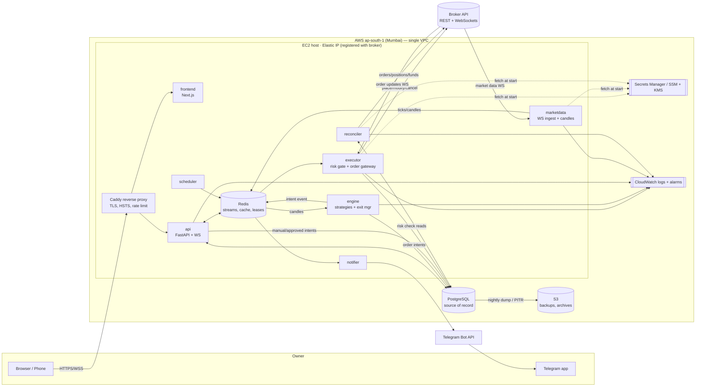

# 4. System Architecture & Cloud Deployment

Status: **Phase 1 draft for owner review** · Last updated: 2026-11-07

## 4.1 Architectural style: modular monolith, multiple processes

One Python codebase (`backend/`) with strict internal module boundaries, deployed as
**several independent processes** that share the code but have separate jobs:

| Process | Instances | Responsibility |
|---|---|---|
| `api` | 1+ (stateless) | FastAPI REST + dashboard WebSocket, auth, config, manual orders → *intents* |
| `engine` | **exactly 1** (lease-enforced) | Strategy evaluation on closed candles, signal generation, position exit management |
| `executor` | **exactly 1** (lease-enforced) | **The only component allowed to call broker write endpoints.** Risk check → idempotent submit → track |
| `marketdata` | 1 | Broker WebSocket ingest, candle building, staleness detection, publishes ticks/candles |
| `reconciler` | 1 | Periodic + event-driven diff of broker state vs our DB; resolves UNKNOWN orders; flags drift |
| `scheduler` | 1 | Market calendar, session open/close routines, EOD snapshots, token purge, backups trigger |
| `notifier` | 1 | Telegram (later email) delivery with retries; never on the critical path |
| `frontend` | 1 | Next.js dashboard (served behind the same reverse proxy) |

**Why not microservices or Kubernetes?** For one user and a handful of orders a day,
microservices add network failure modes, distributed transactions and cost without any
benefit. Separate processes already give fault isolation: a crashed dashboard can't stop
exit management. The module boundaries let us split later if needed.

**Why not serverless?** Broker order calls must originate from a **fixed static IP**,
WebSockets must stay connected all session, and the engine must be a singleton. Serverless
fights all three, and static egress through a NAT gateway costs ~US$35+/month on its own.

## 4.2 System diagram



## 4.3 Core design decisions

### D1. Order lifecycle with exactly-once semantics

```
Signal ─▶ OrderIntent(PENDING_RISK) ─▶ risk engine ─┬▶ REJECTED_RISK (logged, notified)
                                                    └▶ AWAITING_APPROVAL (Manual/Semi)
                                                         └ owner approves (MFA-fresh session)
                                                    └▶ APPROVED ─▶ executor:
   1. persist client_order_id (UUID → broker tag) + state SUBMITTING   [DB commit FIRST]
   2. call broker place_order
        ├ success → store broker_order_id, state OPEN
        ├ explicit reject → REJECTED_BROKER
        └ timeout / 5xx / network error → state UNKNOWN  ◀── NEVER retried blindly
   3. reconciler searches order book by tag:
        ├ found → adopt broker_order_id, continue
        └ not found after N checks over ≥ 30 s → FAILED_NOT_PLACED → may re-submit as a NEW intent only if still valid
```

- A unique DB constraint on `(account_id, client_order_id)` plus a per-signal
  `dedupe_key` make it impossible to insert the same intent twice.
- While **any** order of a strategy/instrument is UNKNOWN, new intents for that pair are blocked.
- Fills come from broker order-update WebSocket events and are confirmed by order-book polling. Notifications fire only after confirmation.

### D2. Singleton enforcement

`engine` and `executor` acquire a Redis lease (`SET key token NX PX 15000`, renewed every
5 s) **and** a PostgreSQL advisory lock. Every write to `orders` includes the lease's
monotonic *fencing token*. If a process loses its lease (e.g. a GC pause), its writes are
rejected. Docker restarts it and it re-acquires the lease safely.

### D3. Fail-closed risk gate

The executor refuses new **entry** orders when any of these is true: market data older than
the threshold (default 5 s for subscribed instruments during session), broker session
invalid, reconciler hasn't completed a clean sync in the last 2 min, kill switch active,
outside the trading window, a risk limit is breached, or the risk configuration can't be
loaded. **Exit** orders are still allowed in degraded states (reducing risk is always permitted).

### D4. Two layers of stop protection

1. **Broker-side** protective stop (SL-M / GTT / Super Order) placed right after entry fills, where the broker supports it. This survives our outages.
2. **Engine-side** management (trailing, time exit, partial booking) that modifies the broker-side order rather than replacing it with in-memory-only stops.

### D5. Mode and kill-switch state live in Postgres, cached in Redis

Trading mode (`MANUAL` default, `SEMI_AUTO`, `FULL_AUTO`) and the kill-switch state are
persisted and versioned. Enabling `FULL_AUTO` requires: typed confirmation, TOTP re-entry,
passing pre-flight checks (paper-trading track record for that strategy, risk config
present, broker reconciled), and records an audit entry. The kill switch:
1. sets `trading_halted=true` (the executor checks it before every broker call);
2. cancels open entry orders;
3. applies the configured position policy (`FLATTEN_ALL` or `PROTECT_ONLY`, i.e. keep positions with broker-side stops);
4. forces mode back to `MANUAL`;
5. can only be cleared by the owner with MFA. The clear does **not** restore the previous mode.

### D6. Startup and recovery sequence (every process restart)

`load config → fetch secrets → verify broker session → full reconciliation (orders, trades,
positions, holdings, funds) → resolve UNKNOWN orders → rebuild engine state from DB +
broker → backfill missing candles → only then mark READY`. Until READY, the executor accepts exits only.

### D7. Paper vs live isolation

`BrokerAdapter` is an interface with `LiveUpstoxAdapter` / `LiveKiteAdapter`,
`PaperBroker` and `ReplayBroker`. Environment selection happens **once at process start**
from `TRADING_ENV=paper|live`. The paper container is never given broker write credentials,
so even a code bug cannot place a real order from paper mode. Paper and live data live in
separate schemas.

### D8. Strategy contract (backtest = paper = live)

```python
class Strategy(Protocol):
    id: str
    def required_history(self) -> int: ...
    def on_candle(self, ctx: StrategyContext, candles: CandleWindow) -> list[SignalProposal]: ...
```

Strategies see only **closed** candles (no partial bar → no repainting or look-ahead),
have no I/O and no broker access, and keep their state in `ctx`. Signals carry a
deterministic `dedupe_key = hash(strategy_id, instrument, timeframe, candle_close_ts, side)`.

## 4.4 Technology stack (evaluated)

| Layer | Choice | Alternatives considered | Reason |
|---|---|---|---|
| Backend | Python 3.12, FastAPI, Pydantic v2, SQLAlchemy 2 (async) + Alembic | Node/NestJS, Go | All official broker SDKs are Python-first; quant ecosystem |
| Indicators | Own vectorised NumPy/pandas implementations, unit-tested against reference values | TA-Lib (C build pain), pandas-ta (maintenance uncertain) | Full control over warm-up and no-look-ahead semantics; tiny code |
| Backtesting | Own event-driven backtester reusing strategy + risk + charges code; optional VectorBT for parameter research | Backtesting.py | Parity with live matters more than speed at this scale |
| Messaging | Redis 7 Streams (consumer groups, ack) | Kafka, RabbitMQ | Enough durability for our event volume; already needed for cache/leases |
| Database | PostgreSQL 16 | TimescaleDB | Time-series volume is small (watchlist candles); monthly partitioning suffices and works on RDS |
| Frontend | Next.js 15 (App Router), React, TypeScript, Tailwind, TanStack Query, TradingView Lightweight Charts | Plain React + Vite | As requested; Lightweight Charts is free (attribution required) |
| Auth | FastAPI-native: Argon2id passwords, TOTP MFA, httpOnly SameSite=strict cookies, short-lived sessions | Auth0/Cognito | Single user; no external dependency in the critical path |
| Reverse proxy | Caddy (auto Let's Encrypt TLS) | Nginx + certbot | Simpler, secure defaults |
| Notifications | Telegram Bot API | Email/SES later | Instant, free, mobile |
| Observability | structlog JSON logs → CloudWatch, Prometheus metrics endpoint, `/health` + `/ready`, CloudWatch alarms | Grafana Cloud free tier | Cheap and adequate |
| Packaging | Docker + Docker Compose; GitHub Actions CI (lint, type check, tests) | ECS/K8s | Matches single-host design |

## 4.5 Cloud provider recommendation: **AWS, Mumbai (ap-south-1)**

| Criterion | AWS | GCP | Azure |
|---|---|---|---|
| India region near NSE/BSE | Mumbai + Hyderabad | Mumbai + Delhi | Pune/Central India + others |
| Static IP for a VM | Elastic IP (free-ish while attached; public IPv4 billed ~US$3.6/mo) | Static external IP (~same) | Static public IP (~same) |
| Cheap secrets | **SSM Parameter Store SecureString (free tier) + KMS** | Secret Manager | Key Vault |
| Managed Postgres with PITR | RDS (db.t4g.micro) | Cloud SQL | Flexible Server |
| Ecosystem / docs | Largest | Good | Good |

All three would work. AWS wins narrowly on cheap secrets, mature RDS and the most
community material for Indian trading setups. **If you already have credits or an account
elsewhere, use that**: the design is portable (Docker Compose + Postgres + Redis).

### Deployment stages and cost (approximate, on-demand, before taxes)

| Stage | Setup | Est. monthly cost |
|---|---|---|
| **Dev (now → Phase 5)** | Your laptop or a codespace with Docker Compose; paper broker | ₹0 |
| **Staging / paper (Phase 7)** | 1 × EC2 `t4g.small` (2 vCPU, 2 GB) + Elastic IP + 30 GB gp3, Postgres + Redis in containers, nightly `pg_dump` → S3, SSM secrets | **~US$18–22 (₹1,500–1,900)** |
| **Production (Phase 8)** | EC2 `t4g.medium` + Elastic IP, **RDS Postgres `db.t4g.micro`** (automated backups, 7-day PITR), Redis in container (state is rebuildable), CloudWatch alarms | **~US$45–60 (₹3,800–5,000)** |
| Add-ons | Broker data plan if needed (e.g. Kite ₹500/mo), domain (~₹1,000/yr) | varies |

*Savings plan / reserved instance after 2–3 months of stability cuts EC2 costs ~30–40%.*

### Security posture of the host
- Security group: inbound 443 only (and 22 restricted to your IP, or better, **SSM Session Manager with no SSH port**).
- Instance role grants read on specific SSM parameters + KMS decrypt only; S3 write to the backup bucket only.
- Postgres/RDS in private subnet, not publicly accessible; TLS required.
- OS auto-patching (unattended-upgrades), Docker images pinned and scanned in CI.

## 4.6 Communication flows

**A. Live signal → order (Semi-auto mode)**
1. `marketdata` closes a 5-min candle → `XADD candles:{instrument}:{tf}`.
2. `engine` consumes it, runs enabled strategies → `trading_signals` row (unique `dedupe_key`) → creates `order_intents` (PENDING_RISK) → `XADD intents`.
3. `executor` runs the pre-trade risk check → `AWAITING_APPROVAL` → `notifier` sends a Telegram message with a deep link; `api` pushes it to the dashboard over WS.
4. Owner approves in the dashboard (session must have done MFA within 12 h; approval expires after configurable TTL, e.g. 2 min or the price drifting > X%).
5. `executor` re-runs the risk check (prices may have moved) → submits → order lifecycle as D1.
6. Broker order-update WS → `order_events` → on fill: create/update `positions`, place broker-side SL → dashboard + Telegram "FILLED (broker-confirmed)".

**B. Exit management**
`engine` evaluates exit rules on every tick/candle for open positions (trailing SL,
target, time exit) → emits *exit intents* (bypass approval in all modes **if** the exit was part
of the approved trade plan, configurable) → `executor` modifies the broker-side SL or
places the exit.

**C. Reconciliation (every 60 s in session + on every reconnect + on startup)**
Fetch broker orders, trades, positions, holdings, funds → diff against DB → apply
broker truth → on unexpected differences (e.g. position changed from the broker app manually)
raise `RECONCILIATION_DRIFT`, notify, and pause automated entries on that instrument until acknowledged.

**D. Daily lifecycle (scheduler, IST)**
08:30 calendar check & instrument master refresh → 08:45 "please log in" Telegram →
owner logs in → reconcile → 09:15 session open → … → 15:10 intraday time exits →
15:30 close → 15:45 EOD snapshot, daily performance → 16:00 token purge → 02:00 backup.

## 4.7 Repository layout (planned)

```
AlgoTrader/
├── backend/app/
│   ├── api/            # FastAPI routers (REST + WS)
│   ├── core/           # config, logging, security, time/calendar
│   ├── db/             # SQLAlchemy models, session, Alembic migrations
│   ├── auth/           # users, sessions, MFA
│   ├── brokers/        # base.py (BrokerAdapter), upstox/, kite/, paper/, replay/
│   ├── marketdata/     # feed client, candle builder, staleness monitor
│   ├── indicators/     # ema, sma, rsi, macd, vwap, atr, pivots
│   ├── strategies/     # ma_crossover, rsi, macd, vwap_intraday, breakout
│   ├── engine/         # strategy runner, signal service, exit manager
│   ├── risk/           # rules, evaluator, position sizing, kill switch
│   ├── execution/      # executor, idempotency, rate limiter, order state machine
│   ├── reconciliation/
│   ├── backtesting/    # replay engine, charges, slippage, reports
│   ├── notifications/
│   └── workers/        # process entrypoints: engine.py, executor.py, ...
├── frontend/           # Next.js app
├── infrastructure/     # docker/, compose files, Caddyfile, aws/ (Terraform or scripts)
├── tests/              # unit/, integration/, broker/, trading_safety/
├── docs/
├── docker-compose.yml
└── .env.example
```
