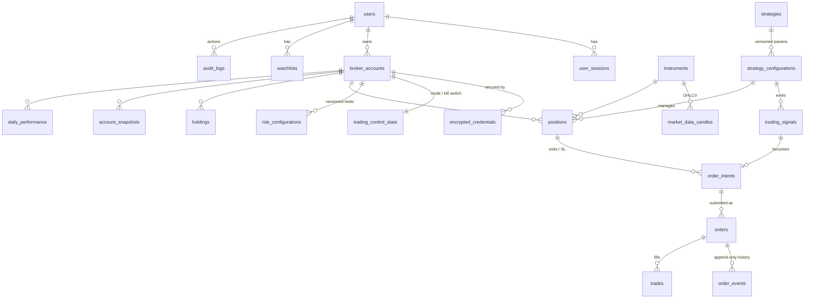

# 5. Database Design

Status: **Phase 1 draft** · DDL: [`schema_draft.sql`](schema_draft.sql) (validated: loads cleanly into PostgreSQL 16)

## 5.1 Entity relationships

## 5.2 Design principles

| Principle | Implementation |
|---|---|
| **Signal ≠ intent ≠ order** | Three tables. A signal is an opinion, an intent is a risk-checked request, an order is what we sent to the broker. Each step is auditable on its own. |
| **Idempotency at the DB level** | `trading_signals.dedupe_key UNIQUE`, `orders (broker_account_id, client_order_id) UNIQUE`. Duplicate inserts fail rather than duplicating orders. |
| **Immutable configuration** | `strategy_configurations` and `risk_configurations` are versioned. Edits insert new rows, so every order can be traced to the exact params and limits in force. |
| **Append-only history** | `order_events` and `audit_logs` have INSERT/SELECT grants only. Audit rows are hash-chained so tampering is detectable. |
| **Broker truth is stored raw** | `broker_position_snapshots` keep the sanitized broker payloads used during reconciliation. |
| **Secrets are ciphertext only** | `encrypted_credentials` stores AES-256-GCM ciphertext + a KMS-wrapped data key. Access tokens get `expires_at` and are deleted after session close. Broker PIN/password/TOTP seed are **never** stored. |
| **Paper/live isolation** | `broker_accounts.environment`; paper runs in a separate Postgres schema with its own DB role. |
| **Money precision** | `NUMERIC(18,4)`. Never floats for prices/P&L in storage. |
| **Time** | All `TIMESTAMPTZ` in UTC; IST conversion only in presentation and the calendar module. |

## 5.3 Key indexes

- Partial index on `orders(status)` for live states → the reconciler's "what's still open" query stays fast.
- `market_data_candles` PK `(instrument_id, timeframe, ts)` + monthly range partitions.
- Time-descending indexes on `trading_signals`, `system_events`, `audit_logs`, `account_snapshots` for dashboard feeds.
- Partial unique index `one_enabled_config` ensures only one live version of a strategy is enabled.

## 5.4 Data retention

| Data | Retention | Mechanism |
|---|---|---|
| Orders, order_events, trades, positions, audit_logs | **≥ 5 years** (aligned with broker/SEBI record-keeping expectations and tax needs) | Kept in DB; yearly archive to S3 Glacier after 2 years |
| 1-minute candles | 2 years in DB | Drop old partitions after export to S3 (Parquet) |
| 5m+ / daily candles | Indefinite | Small volume |
| Ticks | Not persisted (Redis, ~1 session) | Optional Parquet capture for research |
| Broker snapshots | 90 days | Scheduled delete |
| system_events | 180 days | Scheduled delete |
| Access tokens | Until end of trading day | Scheduler purge at 16:00 IST |
| User sessions | 30 days after expiry | Scheduled delete |

## 5.5 Backups

- Production: RDS automated backups with 7-day point-in-time recovery, plus a weekly logical dump to S3 (encrypted, 90-day lifecycle).
- Staging: nightly `pg_dump` → S3.
- **Restore drill** once per phase-7 milestone; documented in `docs/deployment.md`.
