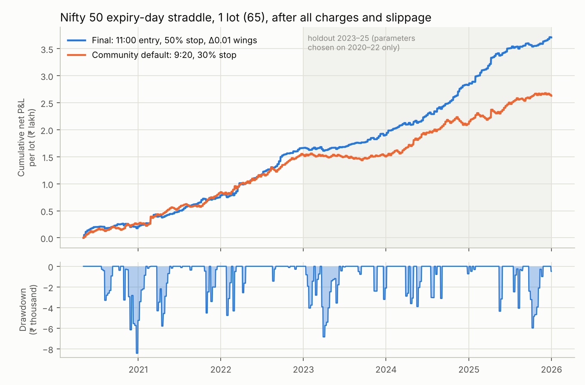
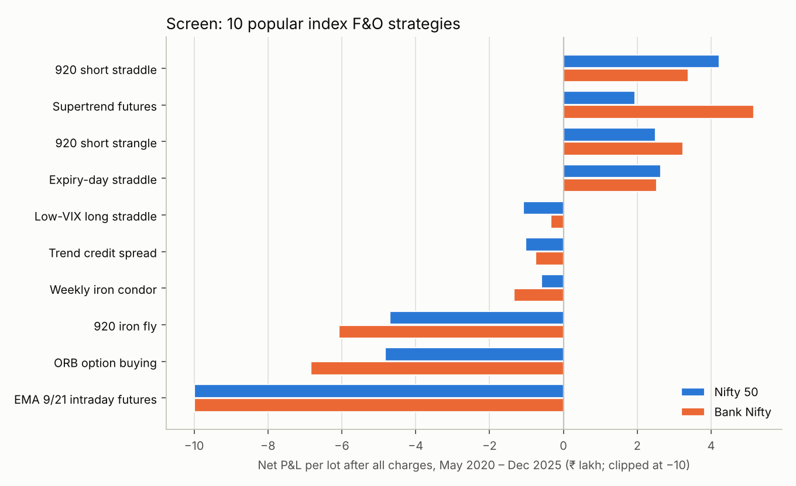
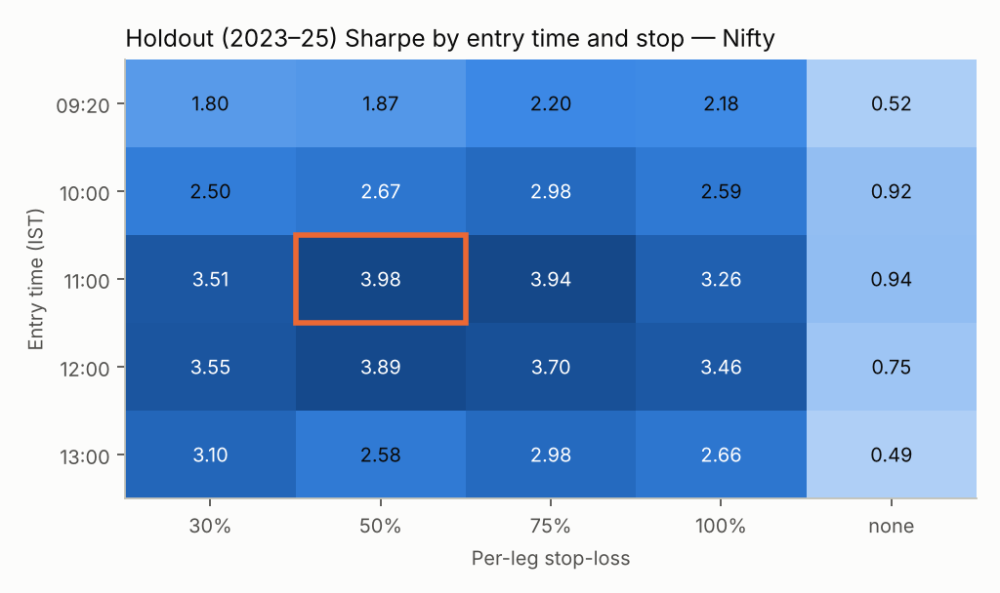
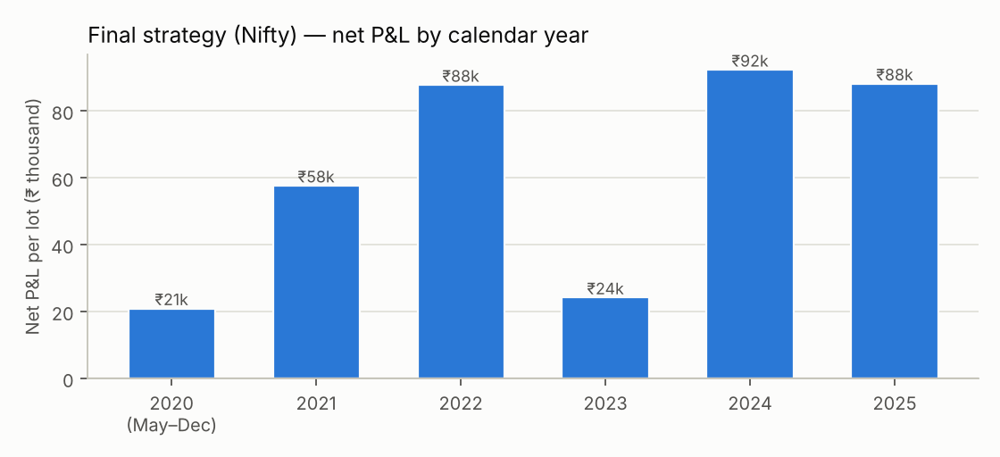

# Index F&O Strategy Backtest: Nifty 50 & Bank Nifty

Status: **Research complete. Strategy selected for paper trading, not for live money.** · Run date: 2026-11-07

> **Read this first.**
> * Option prices in this study are **modelled**, not recorded tick data. The model is anchored every day to real NSE closing prices and was validated on ~45,000 real option prices (§2.3). Its key untested assumption is how fast expiry-day options lose value *between* 11:00 and 15:15 (§6.4).
> * SEBI's study of FY2024-25 found **91% of individual F&O traders lost money** (net losses of ₹1.06 lakh crore) [S1]. A good backtest is a reason to paper-trade, not proof of future profit.
> * This is engineering research, not investment advice.

## 1. Summary

| | |
|---|---|
| **Strategies screened** | 10 widely used retail index F&O strategies (§3), on both indices |
| **Shortlist (5)** | 9:20 short strangle · Expiry-day short straddle · 9:20 short straddle · Supertrend futures · Weekly iron condor (+ a hedged-strangle variant) |
| **Test period** | May 2020 – Dec 2025 (1,400+ sessions) with option prices anchored to real NSE bhavcopies; Apr 2017 – Apr 2020 (incl. the COVID crash) as an extra stress window |
| **Costs** | Charges in force from 1 Apr 2026 applied to *every* trade: STT 0.15% on option premium sold, 0.05% on futures sold, NSE fees, SEBI fee, stamp duty, GST, ₹20/order brokerage, plus slippage |
| **Final strategy** | **Nifty 50 expiry-day hedged short straddle**: every weekly Nifty expiry, sell the ATM call + put at 11:00, buy ~Δ0.01 wings, stop each short leg at +50% of its premium, close everything at 15:15 |

**Final strategy, 1 lot (65 qty), May 2020 – Dec 2025, after all charges and slippage:**

| Metric | Base case | Stress: 2× slippage + stops filled at the worst price of the minute |
|---|---:|---:|
| Net P&L | ₹3,70,945 (≈ ₹66,700 / year) | ₹2,86,320 |
| Sharpe ratio (daily) | 3.49 | 2.65 |
| Max drawdown | ₹8,423 | ₹10,303 |
| Worst single trade | −₹4,758 | −₹6,829 |
| Win rate / profit factor | 79% / 4.43 | 72% / 3.02 |
| Every calendar year profitable? | Yes (2020 partial year: ₹20.9k; 2023 weakest: ₹24.2k) | — |

On top of that stress, if real expiry-day options keep 50% more of their implied volatility after 11:00 than the model assumes, the result falls to ₹1.15 lakh (Sharpe 1.14) but stays positive (§6.4).



## 2. Data and method

### 2.1 Data (all public, pinned, reproducible)

| Data | Source | Coverage used |
|---|---|---|
| NIFTY 50 1-minute candles | `technovusin/nifty50-historical-data` @6eb58d9 (MIT) | Apr 2017 – Dec 2025 |
| NIFTY BANK 1-minute candles | `sandeepkapri/BankNifty-Data` @6bdda6e (MIT) | Apr 2017 – Dec 2025 |
| India VIX daily | Yahoo-derived CSV in `Rithvik-Rajesh/dynamic-portfolio-allocation` @41ca7bb | 2015 – Dec 2025 |
| **NSE F&O bhavcopies** (real daily option prices) | `SantoshSrinivas79/NSE-FNO-Data-bank` @66bbc7f (original NSE archives) | **1,416 trading days, 13 Apr 2020 – 31 Dec 2025**, 4.9 M Nifty/Bank Nifty option rows |

`scripts/fetch_research_data.sh` downloads everything. Days with more than 15 missing minutes (special sessions, data gaps) are excluded, which leaves 2,158 Nifty and 2,156 Bank Nifty sessions.

### 2.2 How option prices are produced

No free source publishes historical *minute-level* option prices, so every option is priced each minute from the **real index path**:

1. **Anchor to the real market every day.** From the previous day's NSE bhavcopy, fit the at-the-money variance and the volatility smile for each expiry (13,392 fitted surfaces). Only information available before the trade is used.
2. **Move with the market during the day.** Implied volatility follows India VIX through the day and responds to the index itself (the "spot–vol" effect: IV rises when the index falls). The sensitivity β was calibrated on **2017–Apr 2020 data only** (Nifty β = 1.95, Bank Nifty 1.38), before the test window.
3. **Price with Black-76** on the forward, using a variance clock that counts trading minutes, with overnights and holidays weighted 0.3 (chosen empirically, §2.3).
4. **Expiry calendar** follows NSE's real history: Nifty weeklies from Feb 2019; Bank Nifty weeklies Thursday → Wednesday (Sep 2023) → discontinued after 13 Nov 2024 [S2]; Tuesday expiries from Sep 2025 [S3]; holiday shifts (e.g. Monday 20 Oct 2025 for Diwali).
5. **Lot sizes:** today's 65 (Nifty) and 30 (Bank Nifty) [S4] for every period, so results are comparable "per lot today".

### 2.3 Validation against real NSE prices

| Check | Nifty | Bank Nifty |
|---|---|---|
| Next-day **closing** price, ATM options (n ≈ 11.8k / 8.7k) | bias +0.2%, typical error 6.3% | bias −0.0%, typical error 5.9% |
| Next-day closing price, ~1% OTM options | bias +0.4%, typical error 7.9% | bias −0.2%, typical error 7.2% |
| Intraday **day-high** of ATM options (drives stop-loss triggers) | bias −0.9%, typical error 5.9% | bias −1.5%, typical error 5.2% |
| Day-high of ATM **puts on big down days** (index down >1%) | bias −1.1%, typical error 3.7% | bias −1.7%, typical error 3.4% |
| **Expiry day**: ATM straddle premium at the open (n = 299 / 254) | model **4.1% below** actual (conservative) | model **5.2% below** actual (conservative) |
| Expiry day: day-high of ATM legs | bias +0.8% (stops trigger slightly more often than they would live) | bias +0.2% |

("Typical error" = median absolute error; "bias" = median signed error.)

**What is not validated:** the *shape* of the intraday decay between the open and the close. Daily bhavcopies only contain OHLC. §6.4 stress-tests this directly.

### 2.4 Fill and cost rules (deliberately conservative)

* Orders fill at the next bar's open after the decision, **plus slippage of max(0.5% of premium, ₹0.10)** per option fill (1 point Nifty / 3 points Bank Nifty per futures fill).
* Stop-losses are checked against each minute's **worst** point (the spot high for short calls, the spot low for short puts). If price gaps through a stop, it fills at the bar's open, not at the stop level.
* Stress mode doubles slippage and fills every stop at the worst price seen in that minute.
* Margin is approximated as 11% of notional for naked short options (+2% extra-loss margin on expiry day) or wing width × lot for hedged positions. Confirm real figures in Upstox's margin calculator.

## 3. The 10 strategies screened

All use **community-standard parameters, not tuned values** (e.g. the AlgoTest "9:20 straddle" [S5]):

| # | Strategy | Rules |
|---|---|---|
| 1 | 9:20 short straddle | Sell ATM CE+PE of the nearest expiry at 9:20; 25% stop per leg; exit 15:15 |
| 2 | 9:20 short strangle | Sell ~0.20-delta CE+PE at 9:20; 30% stop per leg; exit 15:15 |
| 3 | 9:20 iron fly | Short ATM straddle + wings at ± straddle premium; combined stop at 35% of credit |
| 4 | Expiry-day straddle | Strategy 1 on expiry days only, 30% stop |
| 5 | Weekly iron condor | ~0.16-delta short strikes, wings 2% away, entered ≤9 days before expiry; take profit at 50% of credit, stop at 1.5× credit; held to expiry day 15:15 |
| 6 | Trend credit spread | Bull-put or bear-call spread (0.25 delta, 1.5% wide) in the direction of the 20-day EMA; same exits as 5 |
| 7 | ORB option buying | 15-min opening range; buy ATM CE/PE on a breakout close; stop at the opposite end; target at 2× range |
| 8 | Low-VIX long straddle | Buy ATM straddle when VIX < 20th percentile of the past year; +40% / −35% exits |
| 9 | Supertrend futures | Supertrend(10, 3) on 15-min bars, always in the market, positional (incl. carry and rolls) |
| 10 | EMA 9/21 intraday futures | 5-min EMA crossover, flat by 15:15 |

### 3.1 Screen results (May 2020 – Dec 2025, per lot, net of all charges)

| Strategy | Nifty net (₹ lakh) | Nifty Sharpe | Nifty max DD (₹) | Bank Nifty net (₹ lakh) | Bank Nifty Sharpe | Bank Nifty max DD (₹) | Win % (N / BN) | Profitable years (N · BN) |
|---|---:|---:|---:|---:|---:|---:|---:|---:|
| 920 short strangle | +2.50 | 2.90 | 10,033 | +3.23 | 2.92 | 19,126 | 66 / 66 | 6/6 · 6/6 |
| Expiry-day straddle | +2.63 | 2.36 | 14,741 | +2.53 | 1.83 | 19,155 | 65 / 63 | 5/6 · 5/6 |
| 920 short straddle | +4.22 | 1.78 | 60,524 | +3.38 | 1.09 | 77,033 | 60 / 57 | 5/6 · 4/6 |
| Supertrend futures | +1.95 | 0.21 | 4,66,303 | +5.16 | 0.42 | 3,34,694 | 37 / 39 | 3/6 · 4/6 |
| Low-VIX long straddle | −1.09 | −0.82 | 1,11,135 | −0.34 | −0.20 | 1,12,468 | 40 / 45 | 2/6 · 2/6 |
| Weekly iron condor | −0.59 | −0.41 | 1,10,709 | −1.34 | −1.01 | 1,74,857 | 76 / 70 | 2/6 · 2/6 |
| Trend credit spread | −1.03 | −0.98 | 1,09,414 | −0.76 | −0.78 | 81,356 | 73 / 73 | 1/6 · 0/6 |
| ORB option buying | −4.82 | −1.72 | 4,96,352 | −6.84 | −1.68 | 6,99,859 | 36 / 35 | 0/6 · 0/6 |
| 920 iron fly | −4.69 | −3.96 | 4,77,795 | −6.08 | −3.95 | 6,23,066 | 37 / 38 | 0/6 · 0/6 |
| EMA 9/21 intraday futures | −35.97 | −4.63 | 36,09,243 | −43.17 | −4.20 | 43,36,613 | 28 / 29 | 0/6 · 0/6 |



What the screen shows:
* **Option buying loses** (ORB, long straddle). Time decay and costs outweigh the occasional big win, consistent with SEBI's loss data.
* **Intraday futures trend-following is destroyed by the 2026 STT.** 0.05% on every futures sale is ≈ ₹812 per Nifty lot per exit, and the EMA system trades ~900 times a year.
* **Positional premium selling (iron condor, credit spreads) loses** after costs: frequent small wins, then larger losses on trend weeks.
* **The edge sits in intraday short premium with per-leg stop-losses.** Without the stops, the same short straddle *loses* money before costs (checked for 2024). Each stop cuts the losing side early while the other side keeps decaying.

## 4. Shortlist and robustness tests

**Selection rule:** the four strategies with positive net P&L on *both* indices, plus the weekly iron condor as the best-supported defined-risk strategy (290+ trades), to test whether any reasonable settings rescue it. A **hedged strangle** variant (strategy 2 + 0.05-delta wings) was added because hedging cuts margin by ~70%.

Every shortlisted strategy was rerun on: the 2020–22 / 2023–25 halves; the period since SEBI's Nov 2024 weekly-expiry curbs; 2× slippage + worst-price stop fills; Apr 2017 – Apr 2020 with VIX-only pricing; the COVID crash alone; a grid of 12–18 parameter settings; and a 2,000-path block bootstrap of daily P&L for the drawdown distribution.

| Strategy | Index | Full | 2020–22 | 2023–25 | Since Nov 2024 | Stress fills | 2017–Apr 2020 | COVID Feb–Apr 2020 | Settings profitable | Bootstrap 95th-pct DD |
|---|---|---:|---:|---:|---:|---:|---:|---:|---:|---:|
| 920 short strangle | Nifty | +2.50 | +1.43 | +1.06 | +0.51 | +0.58 | +0.31 | −0.06 | 12/12 | ₹17,007 |
| 920 short strangle | Bank Nifty | +3.23 | +2.38 | +0.86 | +0.09 | +0.39 | +1.98 | −0.01 | 12/12 | ₹27,209 |
| 920 hedged strangle | Nifty | −2.18 | −1.00 | −1.18 | −0.46 | −4.43 | −0.88 | +0.05 | 0/18 | ₹2,87,243 |
| 920 hedged strangle | Bank Nifty | −1.66 | −0.42 | −1.23 | −0.71 | −4.71 | +0.23 | +0.02 | 2/18 | ₹2,79,282 |
| **Expiry-day straddle** | **Nifty** | **+2.63** | **+1.54** | **+1.10** | **+0.43** | **+1.44** | **+0.79** | **+0.19** | **12/12** | **₹23,940** |
| Expiry-day straddle | Bank Nifty | +2.53 | +1.84 | +0.69 | −0.03 | +1.11 | +1.70 | +0.23 | 12/12 | ₹33,152 |
| 920 short straddle | Nifty | +4.22 | +2.42 | +1.80 | +0.79 | **−1.18** | +0.71 | −0.20 | 15/15 | ₹64,305 |
| 920 short straddle | Bank Nifty | +3.38 | +3.03 | +0.35 | −0.66 | **−4.80** | +3.62 | +0.21 | 15/15 | ₹1,35,837 |
| Supertrend futures | Nifty | +1.95 | +2.84 | **−0.78** | +0.91 | +0.53 | +1.89 | +1.99 | 11/12 | ₹7,28,710 |
| Supertrend futures | Bank Nifty | +5.16 | +4.12 | +1.18 | −0.28 | +3.35 | +1.79 | +0.16 | 10/12 | ₹7,45,003 |
| Weekly iron condor | Nifty | −0.59 | +0.11 | −0.70 | −0.49 | −0.85 | −0.01 | −0.09 | **0/18** | ₹2,04,663 |
| Weekly iron condor | Bank Nifty | −1.34 | −0.94 | −0.40 | −0.05 | −1.64 | +0.34 | −0.18 | **0/18** | ₹2,58,565 |

(Net P&L in ₹ lakh per lot.)

Verdicts:
* **Rejected: 9:20 short straddle.** It turns sharply negative under realistic execution stress: it stops out almost daily, so fill quality decides everything.
* **Rejected: Supertrend futures.** The 95th-percentile drawdown is ₹7+ lakh per lot, and Nifty lost money in 2023–25.
* **Rejected: iron condor.** Not one of 18 settings was profitable.
* **Rejected: daily hedged strangle.** Buying wings every day costs more in decay than it saves.
* **Finalists: expiry-day straddle and 9:20 strangle.** Both are positive in both halves and in the earlier history, with every setting profitable. The expiry-day straddle keeps **55%** of its profit under stress; the strangle keeps only **23%**, because it trades five times as often.

## 5. Choosing the final strategy

### 5.1 Why the expiry-day straddle on Nifty

1. **Most robust to execution quality**, the largest real-world risk: profit factor 1.50 under stress vs 1.11 for the strangle.
2. **Lowest cost drag:** charges are 11–14% of gross profit, vs ~37% for the daily strangle.
3. **Nifty, not Bank Nifty:** since Nov 2024 Bank Nifty has only monthly expiries (12 a year, 14 trades in our post-rule sample), while Nifty keeps 52 weekly expiries a year and was profitable in that period.
4. **Operationally the simplest to run safely:** one session a week, which suits the manual → semi-automated rollout in Phase 8.

### 5.2 Parameters: chosen on 2020–22, confirmed on 2023–25

A walk-forward test chose the best entry time and stop on **2020–22 only**, then measured them on 2023–25:

| Nifty, 2023–25 holdout | Net P&L | Sharpe | Max DD |
|---|---:|---:|---:|
| Community default (9:20, 30% stop) | ₹1,09,512 | 1.80 | ₹14,741 |
| Chosen on 2020–22 (11:00, 50% stop) | ₹2,37,414 | 3.98 | ₹6,479 |

The full parameter surface is smooth, with the peak **inside** the grid, not at an edge. Running with no stop is far worse everywhere, with worst trades 3–5× larger, so the stop is essential.



### 5.3 Disaster wings

Buying ~0.01-delta wings (far out-of-the-money, very cheap on expiry morning) costs about ₹11k a year per lot in this backtest, but:
* cuts estimated margin from ~₹1.6 lakh to ~₹47k per lot;
* caps the loss if a stop-loss order is not executed (broker outage, freeze, rejection). The backtest assumes stops always work; the wings cover the case where they don't.

| Nifty, per lot | No wings | Δ0.01 wings | Δ0.02 wings |
|---|---:|---:|---:|
| Net P&L | ₹4,32,780 | ₹3,70,945 | ₹3,47,212 |
| Sharpe | 3.94 | 3.49 | 3.30 |
| Est. margin | ₹1,60,882 | ₹46,825 | ₹37,018 |
| Stress (2× slip, worst fills) | ₹3,52,024 | ₹2,86,320 | ₹2,62,525 |

## 6. The final strategy

### 6.1 Rules (to be implemented in Phase 4)

| Rule | Value |
|---|---|
| Instrument | NIFTY 50 weekly options, **expiring that day** |
| Days | Every Nifty weekly expiry (Tuesday since Sep 2025; previous trading day if Tuesday is a holiday) |
| Entry time | 11:00 IST |
| Legs | Buy CE and PE at ~0.01 delta first (hedge before the short legs, for the margin benefit); then sell the ATM CE and ATM PE (strike nearest spot, 50-point steps) |
| Stop-loss | Per short leg, at **1.5× that leg's actual fill price**, placed as a broker-side SL order immediately after the fill is confirmed |
| After a stop | The other short leg and both wings continue |
| Exit | 15:15 IST: cancel open stops, buy back short legs, then sell wings |
| Size | 1 lot until paper and live results match the backtest (§7) |
| Orders | 4 entry + ≤2 stop + ≤4 exit per week, far below the 10 orders/second registration threshold |

### 6.2 Results by year (Nifty, final rules, per lot)



| Window | Trades | Net P&L | Sharpe | Max DD | Worst trade |
|---|---:|---:|---:|---:|---:|
| May 2020 – Dec 2025 | 296 | ₹3,70,945 | 3.49 | ₹8,423 | −₹4,758 |
| 2020–22 (parameter selection) | 139 | ₹1,66,329 | 3.43 | ₹8,423 | −₹4,758 |
| 2023–25 (holdout) | 157 | ₹2,04,616 | 3.55 | ₹6,838 | −₹4,351 |
| Since Nov 2024 rule changes | 59 | ₹1,00,084 | 3.98 | ₹5,974 | −₹4,351 |
| Stress: 2× slippage + worst fills | 296 | ₹2,86,320 | 2.65 | ₹10,303 | −₹6,829 |
| Apr 2017 – Apr 2020 (VIX-only pricing) | 86 | ₹62,870 | 2.27 | ₹7,583 | −₹4,035 |
| COVID crash, Feb – Apr 2020 | 13 | ₹13,318 | 2.62 | ₹7,583 | −₹4,035 |

Block-bootstrap drawdown (2,000 resampled histories): median ₹8,502, 95th percentile ₹12,813, 99th percentile ₹15,686 per lot.

The same rules on Bank Nifty: ₹4.89 lakh, Sharpe 3.71, holdout Sharpe 3.31. That confirms the effect isn't specific to Nifty, but there are only 12 Bank Nifty expiries a year now.

### 6.3 Capital and realistic expectations

* **Margin:** ~₹47k per lot for the hedged position (estimate). **Recommended capital: ₹1.5 lakh per lot.** That covers margin spikes plus the 99th-percentile drawdown several times over.
* **Backtest expectation:** ≈ ₹66k per lot per year after charges (≈ 44% on ₹1.5 lakh).
* **Plan for less:** the conservative case (stress fills + options holding 50% more value after entry) is ≈ ₹20k per lot per year (Sharpe 1.1). Real trading usually lands below a backtest. Treat the conservative case as the planning number until paper trading says otherwise.

### 6.4 The main remaining model risk: afternoon decay on expiry day

If real expiry-day options hold their value later into the afternoon than the model assumes, profits shrink. Stress results, Nifty (unhedged / stress fills):

| IV rise between entry and 15:15 | Final (11:00, 50%) | Community default (9:20, 30%) |
|---|---:|---:|
| 0% (model as validated) | Sharpe 3.94 / 3.17 | 2.36 / 1.26 |
| +25% | 3.52 / 2.55 | 1.98 / 0.78 |
| +50% | 2.64 / 1.75 | 1.25 / 0.17 |
| +100% (extreme) | 0.67 / −0.38 | 0.10 / −0.92 |

The final settings beat the default in every scenario. Whether the edge is large or marginal depends on this one quantity, so **it is the first thing paper trading must measure.**

## 7. What must happen before real money

1. **Measure real intraday decay.** Use Upstox historical candles for expired Nifty option contracts if your plan provides them. Otherwise, record live 1-minute option prices every expiry day during paper trading. Compare them with the model's path from 11:00 to 15:15.
2. **Paper-trade ≥ 12 expiries** (≈ 3 months) through the Phase 5 paper broker on live Upstox data. Go/no-go: average realized slippage ≤ 1% of premium; P&L within the backtest's 10th–90th percentile range; every stop placed and confirmed.
3. **Live Phase 8a:** 1 lot, manual approval of each entry, kill switch tested, daily loss limit ≈ ₹6,000 (≈ 1.3× the worst historical trade).
4. **Regulatory watch:** SEBI has repeatedly targeted expiry-day speculation (weekly-expiry limits, expiry-day extra margin, Tuesday expiry move). A future rule could remove or change the 0DTE opportunity. Re-run this study after any F&O circular.

## 8. Implications for the AlgoTrader build

This changes V1 scope from "equity first, F&O later" to **"Nifty weekly options first"** for the strategy engine. Recorded in `docs/decisions.md`. New requirements for Phases 3–4:

* **Instrument master:** daily Upstox NSE_FO download; resolve the expiring weekly contract and ATM strike at 11:00; reject stale instrument keys.
* **Multi-leg order sequencing:** hedges first, short legs second; exits in reverse. Partial-fill handling per leg. If any short leg fails to fill, unwind the rest (never leave a naked or unbalanced position).
* **Broker-side stops:** SL-limit orders with a limit buffer, because market-protection rules may convert market orders [regulatory doc §3]. Re-check them after every reconnection.
* **Pre-trade margin check** via the Upstox margin API, including the expiry-day extreme-loss margin.
* **Expiry calendar service** (implemented here in `app/backtesting/calendar.py`) shared by backtest, paper and live trading.
* **Paper broker** reuses `app/backtesting/sim.py` fill rules, so paper and backtest fills match.

## 9. Reproduce

```bash
./scripts/fetch_research_data.sh
```

```bash
cd backend && uv sync --extra research
```

```bash
uv run python research/build_option_eod.py 2020-04 2025-12
```

```bash
uv run python -m research.validate_pricing && uv run python -m research.validate_intraday && uv run python -m research.validate_expiry_day
```

```bash
uv run python -m research.run_fno_study screen && uv run python -m research.run_deep && uv run python -m research.walk_forward && uv run python -m research.expiry_grid && uv run python -m research.report
```

The whole pipeline runs in about 15 minutes. Results land in `backend/data/cache/study_*.json` and the charts in `docs/research/img/`.

| Module | Purpose |
|---|---|
| `app/backtesting/calendar.py` | NSE expiry history, lot sizes, strike steps |
| `app/backtesting/vol.py` | Volatility surface from bhavcopies, variance clock, spot–vol model |
| `app/backtesting/pricing.py` | Black-76, implied volatility, smile |
| `app/backtesting/charges.py` | 2026 Indian F&O charges and slippage |
| `app/backtesting/sim.py` | Minute-level multi-leg option and futures simulator |
| `app/backtesting/strategies/fno.py` | The 10 strategies |
| `app/backtesting/metrics.py` | Daily mark-to-market metrics |
| `tests/unit/test_backtesting.py` | Calendar, charges, pricing, clock, stop-loss and metrics tests |

## Sources

* [S1] SEBI FY25 F&O study coverage: [Business Standard](https://www.business-standard.com/markets/news/net-losses-of-traders-in-fo-widens-in-fy25-sebi-study-125070701221_1.html), [Angel One](https://www.angelone.in/news/market-updates/retail-f-o-losses-rose-to-over-1-lakh-crore-trader-participation-dropped-20-percent), [Moneylife](https://moneylife.in/article/106-lakh-crore-lost-by-individual-traders-in-fo-in-fy2425-govt-confirms-sebi-action-on-4-entities-for-market-abuse/79124.html)
* [S2] Bank Nifty weekly expiry discontinued: [Groww](https://groww.in/blog/nse-to-discontinue-weekly-derivative-contracts), [5paisa](https://www.5paisa.com/news/nse-to-phase-out-weekly-index-derivatives-for-bank-nifty-nifty-midcap-select-and-nifty), [Upstox community](https://community.upstox.com/t/nse-to-discontinue-weekly-derivatives-contracts-on-on-bank-nifty-nifty-midcap-and-nifty-financial-services/6878)
* [S3] Tuesday expiry from Sep 2025: [Angel One](https://www.angelone.in/news/market-updates/nifty-weekly-expiry-today-see-what-changed-on-sept-1-2025), [5paisa](https://www.5paisa.com/news/nse-marks-historic-expiry-shift-as-tuesday-becomes-new-expiry-day), [DSIJ](https://www.dsij.in/appmindshare/nse-changes-derivatives-expiry-day-to-tuesday-effective-from-september-2025-49981)
* [S4] Lot sizes 65 / 30 from Jan 2026: [HDFC Sky](https://hdfcsky.com/news/nse-revises-market-lot-sizes-for-major-index-derivatives-effective-january-2026), [Angel One](https://www.angelone.in/news/market-updates/nse-reduces-lot-sizes-in-nifty-and-bank-nifty-derivatives), [AlgoTest](https://algotest.in/blog/nifty-lot-size/)
* [S5] 9:20 straddle definition: [AlgoTest](https://algotest.in/blog/the-920-straddle-strategy-defined), [TradingQnA](https://tradingqna.com/t/atm-short-straddle-intraday-strategy-nifty-bank-nifty/88032), [MarketCalls](https://www.marketcalls.in/?p=58774)
* STT increase from 1 Apr 2026: [Business Today](https://www.businesstoday.in/markets/story/stt-hike-on-fo-trades-to-take-effect-from-april-1-trading-costs-to-rise-522428-2026-03-26), [5paisa](https://www.5paisa.com/news/stt-hike-on-fo-to-take-effect-from-april-1-amid-rising-options-activity), [Business Standard](https://www.business-standard.com/markets/news/markets-fm-hikes-stt-on-fo-trades-surprise-move-126020100888_1.html)
