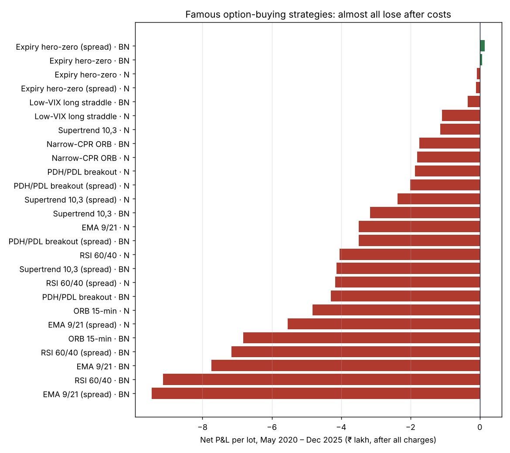
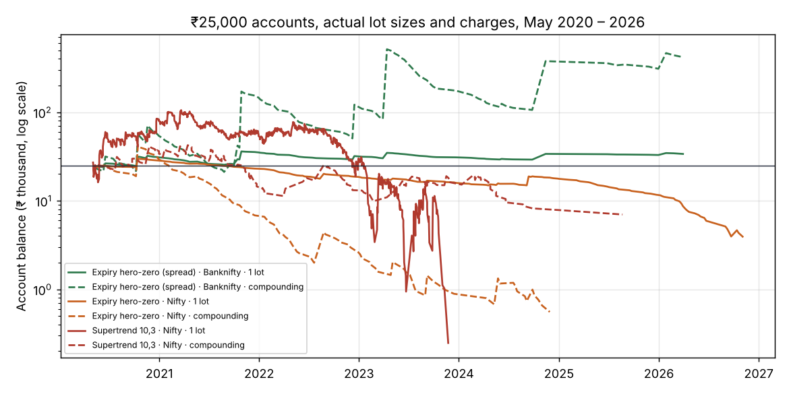

# Plan 2: Low-Capital Option-Buying Strategies, Backtested

Status: **complete** · Run date: 2026-11-08 · Companion to the [full-period F&O study](fno_strategy_backtest.md) (Plan 1, option selling)

> **Read this first.**
> * We tested 8 famous retail option-buying strategies (13 versions including debit-spread variants) on Nifty and Bank Nifty, May 2020 – Dec 2025, with 2026 charges. **24 of the 26 strategy × index results lost money after charges.** The 2 that made money are both Bank Nifty hero-zero. Most of the losers also lost money *before* charges.
> * Only one family made money: **expiry-day "hero-zero" on Bank Nifty** (+₹6,623 per lot, or +₹14,492 as a debit spread, over 5.7 years). That profit comes from a handful of rare big wins: **without its best 3 trades out of 117, it loses.**
> * Option prices are modelled, not recorded. For the cheap out-of-the-money options that hero-zero buys, the model's prices are off by a median ≈ 46–54% at the day's low (§5). Treat every hero-zero number as **highly uncertain**.
> * SEBI's study of FY2024-25: **91% of individual F&O traders lost money**. Option buyers are the main contributors to that figure.
> * This is engineering research, not investment advice.

## 1. The answer in one table

| | **Pick 1: Expiry hero-zero, debit spread (Bank Nifty)** | **Pick 2: Supertrend 10,3 option buying (Nifty)** |
|---|---|---|
| What it does | On expiry day after 13:30, if Bank Nifty breaks the day's high (low), buy the ~0.15-delta call (put) and sell one 500 points further out. Stop at −50% of the debit, otherwise exit 15:15 | Buy the ATM call when the 5-minute Supertrend turns green and the ATM put when it turns red; exit on the opposite flip or 15:15 |
| Money per trade (1 lot) | ≈ ₹300–400 | ≈ ₹4,700–6,000 |
| Trades | ≈ 21 a year in 2020–24; **only ≈ 12 a year now** (Bank Nifty has monthly expiries only since Nov 2024) | ≈ 330 a year |
| Per lot, May 2020 – Dec 2025 (today's lots, 2026 charges) | **+₹14,492** (≈ +₹2,600 a year) | **−₹1,13,742** (≈ −₹20,400 a year) |
| Before charges | +₹25,741 | +₹449 (break-even) |
| Win rate | 9% (wins are rare and large) | 33% |
| With 2× slippage and worst-price stops | +₹10,899 | −₹2,27,595 |
| ₹25,000 account, 1 lot, May 2020 – Apr 2026 | ₹33,773 (+35%), worst fall 21% | **₹248 (wiped out by early 2023)** |
| ₹25,000 account, compounding at 5% risk per trade | ₹4,17,970, worst fall **79%**; **₹6,239 if its best 3 trades are removed** | ₹6,989 (−72%) |
| 2026, data not used in the screen | +₹914 per lot (3 trades) | −₹5,386 per lot (233 trades) |
| Verdict | The only positive result. Fragile, rare, and priced with low accuracy. **Lottery-budget money only** | Best of the everyday ATM-buying systems, but **loses after charges. Paper trading only** |

**Why Supertrend and not a profitable one?** No second strategy made money. Supertrend on Nifty is the runner-up among the strategies that suit small capital: before charges it broke even, while every other ATM-buying system lost money before charges. The low-VIX long straddle (Bank Nifty) lost less in total, −₹35,074. But one lot costs ≈ ₹18,000–23,000 of premium, so a ₹25,000 account could not afford most of its signals (§4).

**My recommendation:**
* **Do not put Plan 2 money into these strategies as an income plan.** The evidence says option buying with the famous rules loses money.
* If you still want a high-risk sleeve, limit it to Pick 1 with a fixed **"can-lose-all" budget** (for example ₹10,000–25,000), at **1 lot per trade, no compounding**. Paper-trade it alongside for at least 12 expiries first.
* Run Pick 2 on paper only. It becomes eligible for real money only if paper results beat its charges for 3 months.



## 2. Strategies tested (rules fixed in advance, nothing tuned)

| # | Strategy | Entry | Exit | Strike |
|---|---|---|---|---|
| 1 | **ORB 15-min** | 1-min close outside the 09:15–09:30 range (first break, by 13:00) | spot back through the other side of the range; target 2× range; 15:15 | ATM |
| 2 | **PDH/PDL breakout** | 5-min close crossing the previous day's high (CE) / low (PE), 09:20–14:30, one per day | −30% / +60% of premium (1:2); 15:15 | ATM |
| 3 | **Supertrend 10,3** | 5-min Supertrend turns green (CE) / red (PE), 09:30–14:30 | opposite flip; 15:15 | ATM |
| 4 | **EMA 9/21 crossover** | 5-min EMA9 crosses EMA21 up (CE) / down (PE), 09:30–14:30 | opposite cross; 15:15 | ATM |
| 5 | **RSI 60/40** | 5-min RSI(14) crosses above 60 (CE) / below 40 (PE), 09:30–14:30 | −30% / +60% of premium; 15:15 | ATM |
| 6 | **Expiry hero-zero** | expiry day 13:30–14:45: 5-min close above the day's high (CE) / below its low (PE), one per day | −50% of premium; 15:15 | ~0.15 delta |
| 7 | **Narrow-CPR ORB** | ORB 15-min, only when yesterday's CPR width is in the narrowest 25% of the previous 50 days | as ORB | ATM |
| 8 | **Low-VIX long straddle** | buy ATM CE + PE when India VIX is in its lowest 20% of the past year (positional) | +40% / −35% of premium; day before expiry | ATM |

**Debit-spread variant** (strategies 2–6): the same signal, but also sell the option 200 points (Nifty) / 500 points (Bank Nifty) further out. This lowers the cost and the time decay but caps the gain.

**Not tested:**
* **VWAP-based rules.** Index data has no volume, so VWAP cannot be computed honestly.
* **Event straddles** (Budget, RBI, election results). A verified event calendar was not available.
* **Sensex weekly expiry**, now a popular hero-zero instrument. There is no Sensex option data in our sources.

## 3. Full results (per lot, today's lot size: Nifty 65, Bank Nifty 30; May 2020 – Dec 2025)

| Strategy | Index | Trades / yr | Premium per lot (avg) | Net P&L per lot | Before charges | Charges | Win % | Profit factor | Profitable years | 2× slippage + worst fills |
|---|---|---:|---:|---:|---:|---:|---:|---:|---:|---:|
| Expiry hero-zero (spread) | Bank Nifty | 21 | ₹415 | **₹14,492** | ₹25,741 | ₹11,248 | 9% | 1.45 | 3/6 | ₹10,899 |
| Expiry hero-zero | Bank Nifty | 21 | ₹500 | **₹6,623** | ₹12,308 | ₹5,685 | 9% | 1.21 | 2/6 | ₹3,674 |
| Expiry hero-zero | Nifty | 28 | ₹346 | **−₹9,006** | −₹1,421 | ₹7,585 | 8% | 0.73 | 2/6 | −₹13,576 |
| Expiry hero-zero (spread) | Nifty | 28 | ₹290 | **−₹10,878** | ₹4,192 | ₹15,070 | 8% | 0.70 | 2/6 | −₹16,452 |
| Low-VIX long straddle | Bank Nifty | 12 | ₹22,810 | **−₹35,074** | −₹25,173 | ₹9,901 | 45% | 0.89 | 2/6 | −₹67,261 |
| Low-VIX long straddle | Nifty | 15 | ₹16,608 | **−₹1,08,606** | −₹97,424 | ₹11,182 | 40% | 0.66 | 2/6 | −₹1,27,679 |
| Supertrend 10,3 | Nifty | 333 | ₹6,070 | **−₹1,13,742** | ₹449 | ₹1,14,191 | 33% | 0.94 | 1/6 | −₹2,27,595 |
| Narrow-CPR ORB | Bank Nifty | 65 | ₹10,174 | **−₹1,74,537** | −₹1,48,933 | ₹25,604 | 37% | 0.73 | 1/6 | −₹2,10,901 |
| Narrow-CPR ORB | Nifty | 61 | ₹6,472 | **−₹1,80,853** | −₹1,59,769 | ₹21,084 | 34% | 0.64 | 0/6 | −₹2,02,381 |
| PDH/PDL breakout | Nifty | 155 | ₹6,359 | **−₹1,86,959** | −₹1,33,375 | ₹53,584 | 34% | 0.81 | 1/6 | −₹2,98,732 |
| PDH/PDL breakout (spread) | Nifty | 155 | ₹4,093 | **−₹2,00,441** | −₹1,01,445 | ₹98,997 | 35% | 0.69 | 0/6 | −₹3,27,703 |
| Supertrend 10,3 (spread) | Nifty | 333 | ₹3,882 | **−₹2,37,756** | −₹26,530 | ₹2,11,226 | 33% | 0.82 | 1/6 | −₹3,98,834 |
| Supertrend 10,3 | Bank Nifty | 305 | ₹10,224 | **−₹3,16,721** | −₹1,96,219 | ₹1,20,502 | 34% | 0.87 | 1/6 | −₹4,89,564 |
| EMA 9/21 | Nifty | 587 | ₹6,056 | **−₹3,48,849** | −₹1,47,959 | ₹2,00,890 | 24% | 0.87 | 0/6 | −₹5,47,651 |
| PDH/PDL breakout (spread) | Bank Nifty | 165 | ₹5,337 | **−₹3,48,902** | −₹2,28,914 | ₹1,19,989 | 31% | 0.59 | 0/6 | −₹5,46,328 |
| RSI 60/40 | Nifty | 459 | ₹5,479 | **−₹4,05,108** | −₹2,51,801 | ₹1,53,307 | 34% | 0.83 | 0/6 | −₹7,04,227 |
| Supertrend 10,3 (spread) | Bank Nifty | 305 | ₹5,126 | **−₹4,13,543** | −₹1,92,931 | ₹2,20,612 | 32% | 0.72 | 0/6 | −₹6,73,267 |
| RSI 60/40 (spread) | Nifty | 440 | ₹3,619 | **−₹4,16,621** | −₹1,44,474 | ₹2,72,147 | 35% | 0.74 | 0/6 | −₹7,06,014 |
| PDH/PDL breakout | Bank Nifty | 165 | ₹10,609 | **−₹4,29,973** | −₹3,64,480 | ₹65,493 | 34% | 0.72 | 0/6 | −₹6,07,154 |
| ORB 15-min | Nifty | 248 | ₹6,611 | **−₹4,82,151** | −₹3,96,143 | ₹86,008 | 36% | 0.77 | 0/6 | −₹5,72,251 |
| EMA 9/21 (spread) | Nifty | 587 | ₹3,914 | **−₹5,54,499** | −₹1,82,927 | ₹3,71,572 | 24% | 0.71 | 0/6 | −₹8,34,526 |
| ORB 15-min | Bank Nifty | 246 | ₹10,614 | **−₹6,82,355** | −₹5,84,768 | ₹97,586 | 35% | 0.76 | 0/6 | −₹8,24,916 |
| RSI 60/40 (spread) | Bank Nifty | 410 | ₹4,766 | **−₹7,15,734** | −₹4,35,289 | ₹2,80,445 | 31% | 0.62 | 0/6 | −₹11,69,810 |
| EMA 9/21 | Bank Nifty | 609 | ₹9,985 | **−₹7,74,166** | −₹5,35,359 | ₹2,38,807 | 24% | 0.79 | 0/6 | −₹11,10,861 |
| RSI 60/40 | Bank Nifty | 436 | ₹8,709 | **−₹9,13,499** | −₹7,50,503 | ₹1,62,996 | 32% | 0.73 | 0/6 | −₹13,30,272 |
| EMA 9/21 (spread) | Bank Nifty | 609 | ₹5,083 | **−₹9,46,339** | −₹5,08,884 | ₹4,37,455 | 21% | 0.60 | 0/6 | −₹14,49,960 |

**Why option buying loses here:**
1. **The signals don't predict enough.** Before any charge, most systems already lose: the index move they catch is smaller than the time value the option loses while waiting. On Nifty, Supertrend is the only one that breaks even before charges.
2. **Charges and spreads add up quickly.** A system with 300–600 trades a year pays ₹1–2.4 lakh per lot in charges over the period (debit spreads up to ₹4.4 lakh), more than any edge it has.
3. **Debit spreads don't fix it.** They halve the premium but double the orders, so charges rise, and they cap the big wins that buyers depend on.
4. **Wins are rare.** Win rates are 24–37% for ATM systems and 8–9% for hero-zero. Losing streaks reach 13–42 trades in a row.

### Consistency over time (net per lot, number of trades in brackets)

| Strategy | Index | 2020–22 | 2023–25 | Since 21 Nov 2024 |
|---|---|---:|---:|---:|
| Expiry hero-zero (spread) | Bank Nifty | ₹9,823 (72) | ₹4,669 (45) | −₹908 (5) |
| Expiry hero-zero | Bank Nifty | ₹1,599 (72) | ₹5,024 (45) | −₹1,049 (5) |
| Expiry hero-zero | Nifty | −₹8,007 (78) | −₹999 (80) | −₹6,760 (29) |
| Expiry hero-zero (spread) | Nifty | −₹7,116 (78) | −₹3,763 (80) | −₹6,984 (29) |
| Low-VIX long straddle | Bank Nifty | −₹42,191 (30) | ₹14,155 (37) | ₹9,131 (5) |
| Low-VIX long straddle | Nifty | −₹10,944 (30) | −₹95,144 (55) | −₹82,669 (22) |
| Supertrend 10,3 | Nifty | −₹7,022 (907) | −₹1,06,720 (947) | −₹58,884 (363) |
| Narrow-CPR ORB | Bank Nifty | −₹1,06,282 (173) | −₹68,255 (190) | −₹45,144 (75) |
| Narrow-CPR ORB | Nifty | −₹88,973 (150) | −₹91,880 (192) | −₹46,423 (75) |
| PDH/PDL breakout | Nifty | −₹1,36,569 (396) | −₹50,390 (469) | ₹7,809 (172) |

Hero-zero worked on Bank Nifty in both halves of the period, but it **has not worked on Nifty**. Nifty is the index that still has weekly expiries. Since Bank Nifty lost its weekly contract (Nov 2024) there have been only 5 Bank Nifty trades, and they lost a little.

## 4. Small-capital accounts (actual lot size on each date, charges in force on each date)

* Accounts start at ₹25,000 or ₹50,000 on 1 May 2020. Nifty data runs to Nov 2026, Bank Nifty to Apr 2026. 2026 was **not** used in the screen above. The 2026 VIX is rebuilt from option prices.
* **1 lot**: one lot per signal when the premium fits in the cash balance.
* **Compounding**: lots = ⌊5% of equity ÷ planned loss per lot⌋. The planned loss is the stop % × premium, or the whole premium when the exit is an indicator flip.
* Both modes: no new trades after a 10% loss in a day.

| Strategy | Start | Sizing | End balance | Return | Worst fall from peak | Trades | 2026 (unseen) per lot |
|---|---:|---|---:|---:|---:|---:|---:|
| Hero-zero spread · Bank Nifty | ₹25,000 | 1 lot | **₹33,773** | +35% | 21% | 120 | ₹914 (3 trades) |
| Hero-zero spread · Bank Nifty | ₹25,000 | compounding | **₹4,17,970** | +1572% | 79% | 120 | ₹914 (3 trades) |
| Hero-zero spread · Bank Nifty | ₹50,000 | 1 lot | **₹58,773** | +18% | 12% | 120 | ₹914 (3 trades) |
| Hero-zero spread · Bank Nifty | ₹50,000 | compounding | **₹9,20,071** | +1740% | 79% | 120 | ₹914 (3 trades) |
| Hero-zero · Bank Nifty | ₹25,000 | 1 lot | **₹27,989** | +12% | 29% | 120 | ₹489 (3 trades) |
| Hero-zero · Bank Nifty | ₹25,000 | compounding | **₹41,543** | +66% | 83% | 120 | ₹489 (3 trades) |
| Hero-zero · Nifty | ₹25,000 | 1 lot | **₹3,933** | −84% | 87% | 182 | −₹7,738 (24 trades) |
| Hero-zero · Nifty | ₹25,000 | compounding | **₹555** | −98% | 99% | 111 | −₹7,738 (24 trades) |
| Supertrend 10,3 · Nifty | ₹25,000 | 1 lot | **₹248** | −99% | 100% | 1,092 | −₹5,386 (233 trades) |
| Supertrend 10,3 · Nifty | ₹25,000 | compounding | **₹6,989** | −72% | 84% | 172 | −₹5,386 (233 trades) |
| Supertrend 10,3 · Nifty | ₹50,000 | 1 lot | **₹590** | −99% | 100% | 1,587 | −₹5,386 (233 trades) |
| Supertrend 10,3 · Bank Nifty | ₹25,000 | compounding | **₹17,752** | −29% | 58% | 153 | ₹37,689 (78 trades) |
| Low-VIX long straddle · Bank Nifty | ₹25,000 | 1 lot | **₹23,740** | −5% | 71% | 18 (49 skipped: premium > cash) | no signal |
| Low-VIX long straddle · Nifty | ₹50,000 | 1 lot | **₹14,889** | −70% | 78% | 58 | no signal |

The full table, including every capital and sizing combination, is in [option_buying/tables.md](option_buying/tables.md).



**The ₹4.2 lakh compounding result is not a forecast.** It depends on a few trades:

| Hero-zero spread, Bank Nifty, ₹25,000 | 1 lot | Compounding |
|---|---:|---:|
| All 120 trades | ₹33,773 | ₹4,17,970 |
| Without the single best trade | ₹26,940 | ₹1,44,979 |
| Without the best 3 trades | ₹15,457 | **₹6,239** |
| Without the best 5 trades | ₹7,437 | **₹425** |

The best trades were on 15 Oct 2020 (+₹6,833 per lot), 28 Oct 2021 (+₹6,821), 13 Nov 2024 (+₹4,663), 13 Apr 2023 (+₹4,531) and 14 Oct 2021 (+₹3,489). The compounding account also grew to 6,240 units (208 lots) in a single trade of a far out-of-the-money option. It is doubtful that size could be filled at the modelled price.

## 5. How reliable are these numbers?

| Check | Result |
|---|---|
| ATM option day-high vs real NSE prices (drives buyers' targets) | model −0.9% (Nifty) / −1.5% (Bank Nifty) vs actual: slightly **against** buyers ([full-period study §2.3](fno_strategy_backtest.md#23-validation-against-real-nse-prices)) |
| **Expiry-day OTM options 0.3–1% out of the money, day-low** (≈ the afternoon price a hero-zero buyer pays), n = 431 / 492 | model **+20.6% (Nifty) / +31.2% (Bank Nifty) too expensive**, median absolute error **46% / 54%** |
| Same options, day-high (the spike that makes hero-zero pay) | model +2.3% / +1.5%, error 7.8% / 6.0% |
| Hero-zero if real entry prices are 20% lower / higher than modelled | Bank Nifty spread: ₹26,273 / ₹2,712 · Bank Nifty plain: ₹18,404 / −₹5,157 · Nifty plain: ₹2,126 / −₹20,138 |

So the model probably makes hero-zero entries look **too expensive**, which would make the real results somewhat better. But the error on individual prices is so large that the sign of the result is not reliable. The day-high check suggests the model captures the winning spikes reasonably well.

**Other limitations:**
* Option prices are modelled minute by minute from real index data and anchored daily to NSE closing prices. No real intraday option prices were used.
* Slippage is max(0.5%, ₹0.10) per fill. On ₹5–15 options that is 1–2% per side.
* About a quarter of hero-zero trades used the lot size of the nearest available date, because a few expiries are missing from the bhavcopy archive. Lot sizes change rarely, so the effect is small.
* 2026 figures use a VIX rebuilt from option prices ([stage-2 study](stage2_paper_trading_backtest.md)).

## 6. If you still run Plan 2: rules I would hold it to

1. Use a **separate capital pot you can lose entirely** (₹10,000–25,000). Never top it up after losses.
2. Trade **Pick 1 only, 1 lot (or a fixed small number of lots), no compounding**. The compounding results rely on 3 trades in 6 years.
3. Expect around **10 losing trades for every winner**, and losing streaks of 28–42 trades. A losing streak alone is not a reason to stop. Stop if the pot falls 50% (₹25,000 → ₹12,500), then review.
4. Paper-trade it in AlgoTrader for at least **12 expiries** before real money, and record the real afternoon prices of the options it would buy. That fixes the model's biggest weakness (§5).
5. Pick 2 runs on **paper only**.

## 7. Reproduce

```bash
cd backend
uv run python -m research.run_buying_study          # screen + windows + stress → data/cache/study_buying.json
uv run python -m research.validate_otm_expiry       # OTM expiry-day price check
uv run python -m research.buying_account "Expiry hero-zero (spread):BANKNIFTY" "Expiry hero-zero:BANKNIFTY" \
    "Expiry hero-zero:NIFTY" "Supertrend 10,3:NIFTY" "Supertrend 10,3:BANKNIFTY"
uv run python -m research.buying_report             # tables + charts
```

Code: `app/backtesting/strategies/buying.py` (strategies), `research/buying_account.py` (accounts), tests in `tests/unit/test_option_buying.py`.
