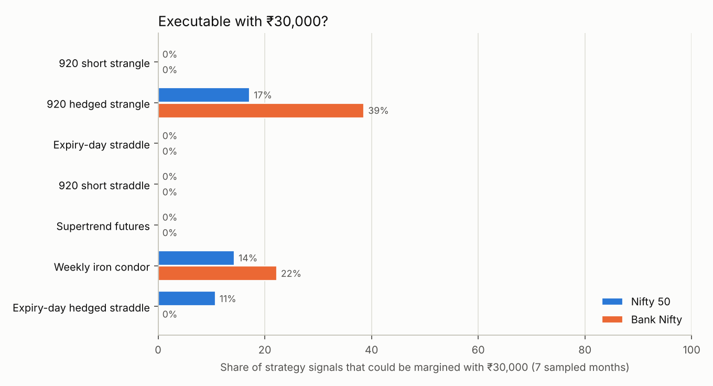
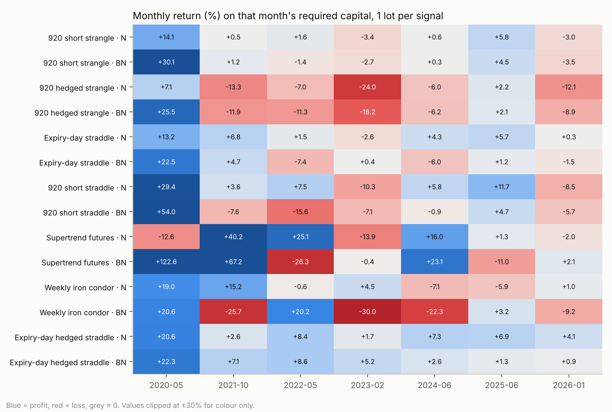

# Sampled-Month Backtest, 2020–2026, with ₹30,000 per Strategy

Status: **complete** · Run date: 2026-11-07 · Companion to [the full-period study](fno_strategy_backtest.md)

> Option prices are **modelled from real index moves and anchored daily to real NSE option closing prices** (validation in the full-period study, §2.3). Margins are a documented **approximation** of NSE SPAN + ELM; NSE's SPAN files aren't in the dataset. Nothing below is invented: where data didn't exist, the month was excluded or the gap is stated.

## 1. Bottom line

1. **₹30,000 cannot trade any shortlisted strategy under current contract sizes.** In the two sampled months after NSE's Nov 2024 lot-size increase (June 2025, January 2026), **not one signal of any strategy could be margined.** The cheapest hedged position needed ₹48k–₹70k per lot; naked straddles, strangles and futures needed ₹1.8–2.4 lakh.
2. **Four strategies executed zero trades in all seven months:** 9:20 short strangle, 9:20 short straddle, expiry-day straddle (naked) and Supertrend futures. Even in 2020–2024, with smaller lots, their margin was ₹38k–₹1.1 lakh per lot.
3. **Only hedged structures ever fit,** and only in 2020–2024: 3 to 54 executed trades each. None produced consistent results. The best ₹30k account (Bank Nifty hedged strangle, +17.6%) made all of its profit in May 2020, lost money in the other four executable months, and had a 33% drawdown.
4. **On the same months with adequate capital** (every signal at 1 lot), the strongest strategies were the **expiry-day hedged straddle** (Nifty and Bank Nifty: profitable in 7 of 7 months), the **expiry-day straddle on Nifty** (6/7) and the **9:20 short strangle on Nifty** (5/7, smallest drawdowns). These are the **2–3 candidates for further testing**, but they need roughly **₹1.5 lakh (hedged) to ₹2.7 lakh (naked) per lot**, not ₹30,000 (§6).



## 2. Method

### 2.1 Random months (identical for every strategy and both indices)

One month per year was drawn **once**, before any results were computed, with `numpy.random.default_rng(20261108)` from the months for which complete data exists (`backend/research/sample_months.py`):

| Year | Eligible months | **Selected** | Why the eligible range is limited |
|---|---|---|---|
| 2020 | May–Dec | **May 2020** | NSE bhavcopies in the archive start 13 Apr 2020 |
| 2021 | Jan–Dec | **Oct 2021** | — |
| 2022 | Jan–Dec | **May 2022** | — |
| 2023 | Jan–Dec | **Feb 2023** | — |
| 2024 | Jan–Dec | **Jun 2024** | — |
| 2025 | Jan–Dec | **Jun 2025** | — |
| 2026 | Jan–Mar | **Jan 2026** | Bank Nifty 1-minute data ends 22 Apr 2026 |

Every trading day in each month was evaluated with each strategy's exact rules: 140 trading days, 28 Nifty expiry days and 22 Bank Nifty expiry days.

### 2.2 Data

| Data | Source | Notes |
|---|---|---|
| Nifty 50 / Nifty Bank 1-minute candles | `technovusin/nifty50-historical-data`, `sandeepkapri/BankNifty-Data` (MIT) | Real index prices for every minute |
| NSE F&O bhavcopies (daily, all contracts) | `SantoshSrinivas79/NSE-FNO-Data-bank` (original NSE archives) | Daily option-surface anchors (13,392 surfaces 2020–25 + 618 for 2026) and **exact lot sizes** |
| India VIX daily | Yahoo-derived CSV (to 31 Dec 2025) | Intraday volatility path |
| **January 2026 VIX** | *Not available in any reachable source.* Rebuilt from real Nifty option prices: 30-day ATM IV from the bhavcopies, calibrated to VIX on 2020–25 only (VIX = 0.44 + 1.055·IV30, R² = 0.957, residual sd 1.12 pts) | Used only for intraday IV movement; the daily anchor is the real 2026 bhavcopy |

**Lot sizes are the real exchange lots on each trade date, read from NSE's own files** (518 Nifty and 498 Bank Nifty lookups, all exact matches):

| Month | Nifty lot | Bank Nifty lot |
|---|---:|---:|
| May 2020 | 75 | 20 (May expiries), 25 (later) |
| Oct 2021 | 50 | 25 |
| May 2022 | 50 | 25 |
| Feb 2023 | 50 | 25 |
| Jun 2024 | 25 | 15 |
| Jun 2025 | 75 | 30 (June monthly), 35 (July monthly) |
| Jan 2026 | 65 | 30 |

### 2.3 Strategies (rules and parameters unchanged)

| Strategy | Rules (as in the full-period study, no changes) |
|---|---|
| 9:20 short strangle | Sell ~0.20-delta CE + PE at 9:20, nearest expiry; 30% stop per leg; exit 15:15 |
| 9:20 hedged strangle | Same + buy ~0.05-delta wings |
| Expiry-day straddle | Expiry days only: sell ATM CE + PE at 9:20; 30% stop per leg; exit 15:15 |
| 9:20 short straddle | Every day: sell ATM CE + PE at 9:20; 25% stop per leg; exit 15:15 |
| Supertrend futures | Supertrend(10, 3) on 15-min bars, always in the market. The indicator warms up on the 60 prior sessions; positions only inside the sampled month, flat at 15:15 on its last day |
| Weekly iron condor | ~0.16-delta shorts, wings 2% away, entered ≤9 days before expiry, take profit 50% of credit, stop 1.5× credit, held to expiry 15:15. Entries only inside the month; exits may fall after it |
| Expiry-day hedged straddle | The previous study's pick: expiry days, 11:00 entry, 50% stop per leg, ~0.01-delta wings, exit 15:15. **Its parameters were chosen on 2020–22 data, so May 2020, Oct 2021 and May 2022 are in-sample for it** (§6.3) |

### 2.4 Capital, margin and execution rules

* **Each (strategy, index) pair is an independent paper account starting at ₹30,000**, carried through the 7 months in order, with profits and losses compounding.
* **Position size:** lots = ⌊0.90 × current equity ÷ margin per lot⌋. If that is below 1, **the trade is not taken** and is logged with the margin it needed (CSV in `docs/research/sampled_months/`).
* **Margin per lot** (`backend/app/backtesting/margin.py`):
  * naked short options: SPAN ≈ 9% of notional + ELM 2%;
  * hedged positions: min(maximum loss, naked SPAN) + ELM 2% + premium paid for the wings;
  * futures: 11% of notional;
  * **+2% extra ELM on expiry day from 20 Nov 2024** (SEBI);
  * full margin is charged intraday too (SEBI peak-margin rules).
* Cross-check: the model gives ₹1.79 lakh (normal day) and ₹2.11 lakh (expiry day) for a 65-lot Nifty short straddle at 25,000. Published 2026 figures are ₹1.6–1.9 lakh and ₹2.0–2.3 lakh [S1].
* **Charges at the rates in force on each trade date:**
  * STT on options sold: 0.05% → 0.0625% (Apr 2023) → 0.1% (Oct 2024) → 0.15% (Apr 2026);
  * STT on futures sold: 0.01% → 0.0125% → 0.02% → 0.05%;
  * NSE transaction charges: 0.053% of option premium before Oct 2024 (the higher of the historical values), 0.03503% after;
  * SEBI fee ₹10/crore; stamp duty 0.003% (options) / 0.002% (futures) on buys; GST 18%; ₹20 brokerage per order (Upstox).
* **Slippage and fills:** max(0.5% of premium, ₹0.10) per option fill; 1 point (Nifty) or 3 points (Bank Nifty) per futures fill. Stops are checked against each minute's worst price and filled at the stop level, or at the bar's open if price gapped through it.
* **No look-ahead:** each decision uses only closed bars, previous-day closes and the previous day's option surface.

## 3. Results with ₹30,000 per account

Per the brief, every strategy is reported separately below, with one row per strategy. Rows with 0 executed trades are strategies that could not be margined with ₹30,000.

**Nifty 50**

| Strategy | Initial | Final | Signals | Executed | Skipped (margin) | Won / lost | Win rate | Gross P&L | Costs | Net P&L | Net return | Max DD | Profit factor | Avg win | Avg loss |
|---|---:|---:|---:|---:|---:|---:|---:|---:|---:|---:|---:|---:|---:|---:|---:|
| 920 short strangle | ₹30,000 | ₹30,000 | 140 | 0 | 140 | 0 / 0 | — | ₹0 | ₹0 | ₹0 | +0.0% | 0.0% | — | — | — |
| 920 hedged strangle | ₹30,000 | ₹26,519 | 140 | 24 | 116 | 7 / 17 | 29.2% | +₹1,136 | ₹4,618 | −₹3,481 | -11.6% | 12.3% | 0.35 | +₹272 | −₹317 |
| Expiry-day straddle | ₹30,000 | ₹30,000 | 28 | 0 | 28 | 0 / 0 | — | ₹0 | ₹0 | ₹0 | +0.0% | 0.0% | — | — | — |
| 920 short straddle | ₹30,000 | ₹30,000 | 140 | 0 | 140 | 0 / 0 | — | ₹0 | ₹0 | ₹0 | +0.0% | 0.0% | — | — | — |
| Supertrend futures | ₹30,000 | ₹30,000 | 103 | 0 | 103 | 0 / 0 | — | ₹0 | ₹0 | ₹0 | +0.0% | 0.0% | — | — | — |
| Weekly iron condor | ₹30,000 | ₹28,168 | 35 | 5 | 30 | 4 / 1 | 80.0% | −₹846 | ₹986 | −₹1,832 | -6.1% | 17.3% | 0.55 | +₹552 | −₹4,038 |
| Expiry-day hedged straddle | ₹30,000 | ₹33,386 | 28 | 3 | 25 | 3 / 0 | 100.0% | +₹3,967 | ₹581 | +₹3,386 | +11.3% | 0.0% | ∞ | +₹1,129 | — |

**Bank Nifty**

| Strategy | Initial | Final | Signals | Executed | Skipped (margin) | Won / lost | Win rate | Gross P&L | Costs | Net P&L | Net return | Max DD | Profit factor | Avg win | Avg loss |
|---|---:|---:|---:|---:|---:|---:|---:|---:|---:|---:|---:|---:|---:|---:|---:|
| 920 short strangle | ₹30,000 | ₹30,000 | 140 | 0 | 140 | 0 / 0 | — | ₹0 | ₹0 | ₹0 | +0.0% | 0.0% | — | — | — |
| 920 hedged strangle | ₹30,000 | ₹35,284 | 140 | 54 | 86 | 30 / 24 | 55.6% | +₹15,921 | ₹10,638 | +₹5,284 | +17.6% | 33.2% | 1.19 | +₹1,111 | −₹1,169 |
| Expiry-day straddle | ₹30,000 | ₹30,000 | 22 | 0 | 22 | 0 / 0 | — | ₹0 | ₹0 | ₹0 | +0.0% | 0.0% | — | — | — |
| 920 short straddle | ₹30,000 | ₹30,000 | 140 | 0 | 140 | 0 / 0 | — | ₹0 | ₹0 | ₹0 | +0.0% | 0.0% | — | — | — |
| Supertrend futures | ₹30,000 | ₹30,000 | 96 | 0 | 96 | 0 / 0 | — | ₹0 | ₹0 | ₹0 | +0.0% | 0.0% | — | — | — |
| Weekly iron condor | ₹30,000 | ₹30,484 | 27 | 6 | 21 | 5 / 1 | 83.3% | +₹1,708 | ₹1,224 | +₹484 | +1.6% | 14.6% | 1.11 | +₹946 | −₹4,248 |
| Expiry-day hedged straddle | ₹30,000 | ₹30,000 | 22 | 0 | 22 | 0 / 0 | — | ₹0 | ₹0 | ₹0 | +0.0% | 0.0% | — | — | — |

## 4. Month-wise and year-wise results (₹30,000 accounts)

One month was sampled per year, so the month-wise and year-wise tables are the same table.

Cells show net P&L (executed / skipped trades). Skipped = margin per lot exceeded 90% of equity.

**Nifty 50**

| Strategy | 2020-05 | 2021-10 | 2022-05 | 2023-02 | 2024-06 | 2025-06 | 2026-01 |
|---|---:|---:|---:|---:|---:|---:|---:|
| 920 short strangle | ₹0 (0/19) | ₹0 (0/20) | ₹0 (0/21) | ₹0 (0/20) | ₹0 (0/19) | ₹0 (0/21) | ₹0 (0/20) |
| 920 hedged strangle | −₹103 (1/18) | +₹231 (3/17) | −₹184 (3/18) | −₹163 (4/16) | −₹3,262 (13/6) | ₹0 (0/21) | ₹0 (0/20) |
| Expiry-day straddle | ₹0 (0/4) | ₹0 (0/4) | ₹0 (0/4) | ₹0 (0/4) | ₹0 (0/4) | ₹0 (0/4) | ₹0 (0/4) |
| 920 short straddle | ₹0 (0/19) | ₹0 (0/20) | ₹0 (0/21) | ₹0 (0/20) | ₹0 (0/19) | ₹0 (0/21) | ₹0 (0/20) |
| Supertrend futures | ₹0 (0/18) | ₹0 (0/11) | ₹0 (0/14) | ₹0 (0/18) | ₹0 (0/11) | ₹0 (0/17) | ₹0 (0/14) |
| Weekly iron condor | ₹0 (0/5) | ₹0 (0/5) | ₹0 (0/5) | ₹0 (0/5) | −₹1,832 (5/0) | ₹0 (0/5) | ₹0 (0/5) |
| Expiry-day hedged straddle | ₹0 (0/4) | ₹0 (0/4) | ₹0 (0/4) | ₹0 (0/4) | +₹3,386 (3/1) | ₹0 (0/4) | ₹0 (0/4) |

**Bank Nifty**

| Strategy | 2020-05 | 2021-10 | 2022-05 | 2023-02 | 2024-06 | 2025-06 | 2026-01 |
|---|---:|---:|---:|---:|---:|---:|---:|
| 920 short strangle | ₹0 (0/19) | ₹0 (0/20) | ₹0 (0/21) | ₹0 (0/20) | ₹0 (0/19) | ₹0 (0/21) | ₹0 (0/20) |
| 920 hedged strangle | +₹20,224 (14/5) | −₹3,104 (14/6) | −₹6,518 (11/10) | −₹4,380 (4/16) | −₹937 (11/8) | ₹0 (0/21) | ₹0 (0/20) |
| Expiry-day straddle | ₹0 (0/4) | ₹0 (0/4) | ₹0 (0/4) | ₹0 (0/4) | ₹0 (0/4) | ₹0 (0/1) | ₹0 (0/1) |
| 920 short straddle | ₹0 (0/19) | ₹0 (0/20) | ₹0 (0/21) | ₹0 (0/20) | ₹0 (0/19) | ₹0 (0/21) | ₹0 (0/20) |
| Supertrend futures | ₹0 (0/14) | ₹0 (0/9) | ₹0 (0/19) | ₹0 (0/11) | ₹0 (0/13) | ₹0 (0/16) | ₹0 (0/14) |
| Weekly iron condor | +₹4,731 (5/0) | ₹0 (0/5) | ₹0 (0/5) | ₹0 (0/5) | −₹4,248 (1/4) | ₹0 (0/1) | ₹0 (0/1) |
| Expiry-day hedged straddle | ₹0 (0/4) | ₹0 (0/4) | ₹0 (0/4) | ₹0 (0/4) | ₹0 (0/4) | ₹0 (0/1) | ₹0 (0/1) |

### 4.1 Why trades were skipped: margin needed per lot

Smallest margin per lot (₹) required by any signal in the month; ✅ = at least one trade fit within ₹27,000 (90% of ₹30,000).

**Nifty 50**

| Strategy | 2020-05 | 2021-10 | 2022-05 | 2023-02 | 2024-06 | 2025-06 | 2026-01 |
|---|---:|---:|---:|---:|---:|---:|---:|
| 920 short strangle | ₹73,749 | ₹96,171 | ₹86,796 | ₹95,503 | ₹60,416 | ₹202,691 | ₹180,460 |
| 920 hedged strangle | ✅ | ✅ | ✅ | ✅ | ✅ | ₹59,472 | ₹47,900 |
| Expiry-day straddle | ₹75,084 | ₹97,846 | ₹87,587 | ₹96,109 | ₹62,470 | ₹240,099 | ₹211,313 |
| 920 short straddle | ₹73,749 | ₹96,171 | ₹86,796 | ₹95,503 | ₹60,416 | ₹202,691 | ₹180,460 |
| Supertrend futures | ₹73,220 | ₹96,238 | ₹87,237 | ₹95,196 | ₹61,468 | ₹202,861 | ₹180,093 |
| Weekly iron condor | ₹28,086 | ₹33,351 | ₹29,838 | ₹33,429 | ✅ | ₹70,210 | ₹62,710 |
| Expiry-day hedged straddle | ₹52,783 | ₹44,253 | ₹38,574 | ₹39,688 | ✅ | ₹128,233 | ₹93,597 |

**Bank Nifty**

| Strategy | 2020-05 | 2021-10 | 2022-05 | 2023-02 | 2024-06 | 2025-06 | 2026-01 |
|---|---:|---:|---:|---:|---:|---:|---:|
| 920 short strangle | ₹38,656 | ₹101,706 | ₹91,139 | ₹109,351 | ₹77,534 | ₹182,992 | ₹195,131 |
| 920 hedged strangle | ✅ | ✅ | ✅ | ✅ | ✅ | ₹55,625 | ₹60,019 |
| Expiry-day straddle | ₹39,629 | ₹104,030 | ₹91,886 | ₹109,547 | ₹77,534 | ₹220,730 | ₹227,772 |
| 920 short straddle | ₹38,656 | ₹101,706 | ₹91,139 | ₹109,351 | ₹77,534 | ₹182,992 | ₹195,131 |
| Supertrend futures | ₹38,587 | ₹101,607 | ₹91,612 | ₹110,643 | ₹79,843 | ₹183,206 | ₹194,324 |
| Weekly iron condor | ✅ | ₹34,855 | ₹33,175 | ₹39,021 | ✅ | ₹64,306 | ₹68,964 |
| Expiry-day hedged straddle | ₹39,975 | ₹57,357 | ₹58,547 | ₹53,622 | ₹34,877 | ₹117,513 | ₹138,364 |

### 4.2 Does the conclusion depend on the margin model?

| Strategy | Index | Executed (base) | Executed (margins −20%, 100% utilisation) | Final capital (lenient) | Executed (margins +20%) |
|---|---|---:|---:|---:|---:|
| 920 short strangle | Nifty 50 | 0/140 | 0 | ₹30,000 | 0 |
| 920 short strangle | Bank Nifty | 0/140 | 0 | ₹30,000 | 0 |
| 920 hedged strangle | Nifty 50 | 24/140 | 42 | ₹19,394 | 10 |
| 920 hedged strangle | Bank Nifty | 54/140 | 87 | ₹31,548 | 9 |
| Expiry-day straddle | Nifty 50 | 0/28 | 0 | ₹30,000 | 0 |
| Expiry-day straddle | Bank Nifty | 0/22 | 0 | ₹30,000 | 0 |
| 920 short straddle | Nifty 50 | 0/140 | 0 | ₹30,000 | 0 |
| 920 short straddle | Bank Nifty | 0/140 | 0 | ₹30,000 | 0 |
| Supertrend futures | Nifty 50 | 0/103 | 0 | ₹30,000 | 0 |
| Supertrend futures | Bank Nifty | 0/96 | 0 | ₹30,000 | 0 |
| Weekly iron condor | Nifty 50 | 5/35 | 25 | ₹40,478 | 1 |
| Weekly iron condor | Bank Nifty | 6/27 | 19 | ₹23,846 | 5 |
| Expiry-day hedged straddle | Nifty 50 | 3/28 | 3 | ₹33,386 | 2 |
| Expiry-day hedged straddle | Bank Nifty | 0/22 | 1 | ₹28,161 | 0 |

Even with margins 20% lower than modelled and 100% of capital usable, the naked and futures strategies still execute **zero** trades. None of the hedged ones become consistent: the Nifty hedged strangle ends at ₹19,394, the Bank Nifty iron condor at ₹23,846. The conclusion doesn't depend on the margin approximation.

## 5. Same months with adequate capital (for choosing what to test next)

The ₹30,000 accounts trade too rarely to judge strategy quality. To compare the strategies themselves on the same seven months, each signal is taken at 1 lot. Each month's account is sized to that month's largest margin need (÷ 0.90), and returns are compounded across the seven months.

| Strategy | Index | Positive months | Compounded return (7 months) | Worst month | Monthly Sharpe (ann.) | Max DD (monthly) | Profit factor | Win rate | 1-lot net P&L | Costs | Capital needed per lot (2025–26 months) |
|---|---|---:|---:|---:|---:|---:|---:|---:|---:|---:|---:|
| 920 short strangle | Nifty 50 | 5/7 | +16.1% | -3.4% | 1.43 | 3.4% | 1.40 | 63% | +₹19,489 | ₹14,178 | ₹273,896 |
| 920 short strangle | Bank Nifty | 4/7 | +27.7% | -3.5% | 1.29 | 4.1% | 1.23 | 61% | +₹13,861 | ₹14,776 | ₹253,080 |
| 920 hedged strangle | Nifty 50 | 2/7 | -44.5% | -24.0% | -2.75 | 48.2% | 0.60 | 46% | −₹29,517 | ₹27,572 | ₹126,925 |
| 920 hedged strangle | Bank Nifty | 2/7 | -30.0% | -18.2% | -1.07 | 44.2% | 0.62 | 49% | −₹32,265 | ₹28,310 | ₹190,772 |
| Expiry-day straddle | Nifty 50 | 6/7 | +32.2% | -2.6% | 3.02 | 2.6% | 3.48 | 71% | +₹37,172 | ₹2,988 | ₹273,896 |
| Expiry-day straddle | Bank Nifty | 4/7 | +11.8% | -7.4% | 0.75 | 12.8% | 1.08 | 55% | +₹2,522 | ₹2,432 | ₹253,080 |
| 920 short straddle | Nifty 50 | 5/7 | +39.7% | -10.3% | 1.57 | 10.3% | 1.29 | 57% | +₹41,381 | ₹16,565 | ₹273,896 |
| 920 short straddle | Bank Nifty | 2/7 | +9.2% | -15.6% | 0.50 | 29.1% | 0.93 | 51% | −₹12,915 | ₹18,639 | ₹253,080 |
| Supertrend futures | Nifty 50 | 4/7 | +51.9% | -13.9% | 1.43 | 13.9% | 1.14 | 40% | +₹55,351 | ₹31,743 | ₹234,274 |
| Supertrend futures | Bank Nifty | 4/7 | +205.7% | -26.3% | 1.81 | 26.6% | 1.31 | 42% | +₹119,604 | ₹30,199 | ₹220,624 |
| Weekly iron condor | Nifty 50 | 4/7 | +25.7% | -7.1% | 1.39 | 12.5% | 1.26 | 86% | +₹8,190 | ₹6,931 | ₹80,016 |
| Weekly iron condor | Bank Nifty | 3/7 | -45.1% | -30.0% | -1.09 | 54.5% | 0.48 | 63% | −₹25,027 | ₹5,471 | ₹76,627 |
| Expiry-day hedged straddle | Nifty 50 | 7/7 | +62.9% | +1.7% | 4.33 | 0.0% | 8.95 | 89% | +₹45,711 | ₹5,570 | ₹152,041 |
| Expiry-day hedged straddle | Bank Nifty | 7/7 | +56.9% | +0.9% | 3.46 | 0.0% | 5.15 | 86% | +₹34,555 | ₹4,431 | ₹153,738 |



## 6. Ranking and selection

### 6.1 Consolidated ranking

Ranked on the four requested criteria. Win rate and total profit are deliberately **not** used on their own.
* **Risk-adjusted:** annualised Sharpe ratio of monthly returns.
* **Consistency:** number of profitable months.
* **Profitability:** compounded 7-month return.
* **Drawdown:** maximum drawdown.

Average of the four ranks (1 = best of 14). ₹30k column: trades executed with ₹30,000.

| Rank | Strategy | Index | Risk-adjusted (Sharpe) | Consistency (+months) | Profitability (return) | Drawdown | Composite | Executable with ₹30k |
|---:|---|---|---:|---:|---:|---:|---:|---:|
| 1 | Expiry-day hedged straddle | Nifty 50 | 1.0 | 1.5 | 2.0 | 1.5 | **1.50** | 3/28 |
| 2 | Expiry-day hedged straddle | Bank Nifty | 2.0 | 1.5 | 3.0 | 1.5 | **2.00** | 0/22 |
| 3 | Expiry-day straddle | Nifty 50 | 3.0 | 3.0 | 6.0 | 3.0 | **3.75** | 0/28 |
| 4 | 920 short straddle | Nifty 50 | 5.0 | 4.5 | 5.0 | 6.0 | **5.12** | 0/140 |
| 5 | Supertrend futures | Bank Nifty | 4.0 | 8.0 | 1.0 | 10.0 | **5.75** | 0/96 |
| 6 | 920 short strangle | Nifty 50 | 7.0 | 4.5 | 9.0 | 4.0 | **6.12** | 0/140 |
| 7 | Supertrend futures | Nifty 50 | 6.0 | 8.0 | 4.0 | 9.0 | **6.75** | 0/103 |
| 8 | 920 short strangle | Bank Nifty | 9.0 | 8.0 | 7.0 | 5.0 | **7.25** | 0/140 |
| 9 | Weekly iron condor | Nifty 50 | 8.0 | 8.0 | 8.0 | 7.0 | **7.75** | 5/35 |
| 10 | Expiry-day straddle | Bank Nifty | 10.0 | 8.0 | 10.0 | 8.0 | **9.00** | 0/22 |
| 11 | 920 short straddle | Bank Nifty | 11.0 | 13.0 | 11.0 | 11.0 | **11.50** | 0/140 |
| 12 | 920 hedged strangle | Bank Nifty | 12.0 | 13.0 | 12.0 | 12.0 | **12.25** | 54/140 |
| 13 | Weekly iron condor | Bank Nifty | 13.0 | 11.0 | 14.0 | 14.0 | **13.00** | 6/27 |
| 14 | 920 hedged strangle | Nifty 50 | 14.0 | 13.0 | 13.0 | 13.0 | **13.25** | 24/140 |

**₹30,000 view:** the only accounts that traded at all are the hedged structures in §3. Every one is unsuitable:
* Bank Nifty hedged strangle: +17.6%, but 1 profitable month of 5 and a 33% drawdown.
* Nifty hedged strangle: −11.6%, with costs larger than the gross profit.
* Iron condors: −6.1% (Nifty) and +1.6% (Bank Nifty), from 5–6 trades.
* Nifty expiry-day hedged straddle: +11.3%, but only 3 trades, all in June 2024.

**No strategy shows consistent, executable results with ₹30,000.**

### 6.2 The 2–3 strongest strategies for further testing

| Pick | Strategy | Why | What it needs |
|---|---|---|---|
| **1** | **Expiry-day hedged straddle (Nifty; Bank Nifty as a second instrument)** | Ranked 1st and 2nd. Profitable in 7/7 months on both indices, no losing month, profit factor 8.95 (Nifty). Defined risk. Profitable in all 4 months outside its parameter-selection window (§6.3) | **≈ ₹1.5 lakh per lot** at 2025–26 contract sizes (margin ₹0.9–1.3 lakh on expiry day + buffer) |
| **2** | **Expiry-day straddle, community rules (Nifty)** | Ranked 3rd. 6/7 profitable months, profit factor 3.48, worst month −2.6%. Rules never tuned, so no selection bias | ≈ ₹2.7 lakh per lot (naked; expiry-day ELM) |
| **3** | **9:20 short strangle (Nifty)** | 5/7 profitable months, smallest drawdown of the daily strategies (3.4%), and positive under the full study's execution stress | ≈ ₹2.7 lakh per lot (naked) |

**Not selected:**
* **9:20 short straddle** (rank 4): turned negative under realistic execution stress in the full study.
* **Supertrend futures** (Bank Nifty rank 5): 26% monthly drawdown here and a ₹7 lakh+ simulated drawdown in the full study.
* **Hedged strangle and Bank Nifty iron condor:** loss-making.
* **Nifty iron condor:** loss-making over the full period.

### 6.3 Selection-bias check for pick 1

The expiry-day hedged straddle's 11:00 / 50% settings were chosen on 2020–22 data. Its months outside that window:

| Index | Month | Trades | Net P&L (1 lot) | Return on month's capital need |
|---|---|---:|---:|---:|
| Nifty 50 | 2023-02 | 4 | +₹1,068 | +1.7% |
| Nifty 50 | 2024-06 | 4 | +₹4,094 | +7.3% |
| Nifty 50 | 2025-06 | 4 | +₹10,442 | +6.9% |
| Nifty 50 | 2026-01 | 4 | +₹5,383 | +4.1% |
| Bank Nifty | 2023-02 | 4 | +₹5,490 | +5.2% |
| Bank Nifty | 2024-06 | 4 | +₹2,274 | +2.6% |
| Bank Nifty | 2025-06 | 1 | +₹1,696 | +1.3% |
| Bank Nifty | 2026-01 | 1 | +₹1,388 | +0.9% |

All eight out-of-window month results are positive. Bank Nifty June 2025 and January 2026 contain **one** trade each, because Bank Nifty now has monthly expiries only.

## 7. Limitations

* **Small samples.** Seven months is 140 trading days; expiry strategies have only 22–28 signals, and the ₹30k accounts executed 0–54 trades. Treat the numbers as evidence for *what to test next*, not as performance estimates.
* **Modelled option prices.** The daily anchor is real NSE prices; the intraday path is modelled. The full study's main untested risk applies: real afternoon decay on expiry days (§6.4 of that report).
* **Approximate margins.** These are not NSE SPAN files. A ±20% sensitivity is shown (§4.2), and broker margins also differ: some charge more than exchange minimums.
* **May 2020 intraday margins:** brokers then allowed lower intraday margins than the full margin used here, so May 2020 executability is understated (conservative).
* **January 2026 uses the rebuilt VIX** for intraday IV movement (§2.2).
* **Not modelled:** order rejections, freeze limits, Upstox's possible per-order API fee, margin calls on multi-day iron condors, and partial fills.
* **Bank Nifty since Nov 2024 trades only monthly expiries,** so its expiry-day strategies have 1 trade in June 2025 and 1 in January 2026.

## 8. Correction to the full-period study

The full-period study estimated the expiry-day hedged straddle's margin at **~₹47k per lot**. That figure left out the **2% ELM on short options and the extra 2% expiry-day ELM**. Under the margin model used here, the margin is about **₹0.9–1.3 lakh per lot** at 2025–26 contract sizes. That report's per-lot P&L, Sharpe ratios and drawdowns are unaffected; its return-on-margin percentages and the "₹1.5 lakh per lot" capital advice have been corrected (see its §5.3 and §6.3).

## 9. Reproduce

```bash
./scripts/fetch_research_data.sh
```

```bash
cd backend && uv run python research/build_option_eod.py 2026-01 2026-04 && uv run python -m research.lot_table && uv run python -m research.vix_proxy
```

```bash
uv run python -m research.sampled_backtest && uv run python -m research.sampled_report
```

Trade-level detail: [`sampled_months/executed_trades_30k.csv`](sampled_months/executed_trades_30k.csv) and [`sampled_months/skipped_signals_30k.csv`](sampled_months/skipped_signals_30k.csv).

## Sources

* [S1] 2026 short-straddle margin figures: [Alice Blue: F&O margin requirements 2026](https://aliceblueonline.com/blog/fo-margin-requirements-india-2026), [AlgoTest: short straddle](https://algotest.in/blog/short-straddle-strategy/)
* Lot-size history: [Zerodha bulletin (Nov 2024 revision)](https://zerodha.com/marketintel/bulletin/393605/revision-in-lot-size-of-index-derivative-contracts-from-november-20-2024), [Zerodha bulletin (Apr 2024)](https://zerodha.com/marketintel/bulletin/375282/revision-in-lot-size-of-index-derivative-contracts-2), [Fyers: Bank Nifty 25 → 15](https://fyers.in/notice-board/revision-in-lot-size-of-nifty-bank-from-25-qty-to-15-qty/), [Business Standard: Bank Nifty 35](https://www.business-standard.com/amp/markets/capital-market-news/nse-revises-market-lot-sizes-for-nifty-bank-nifty-midcap-select-f-o-contracts-125033100440_1.html), [Ventura: Jan 2026 lot changes](https://www.venturasecurities.com/blog/nifty-bank-nifty-lot-size-changes-january-2026-know-how-it-impacts-traders/). The lots actually used were read from NSE bhavcopies.
* STT and other charges, expiry and SEBI rules: see the full-period study's source list.
