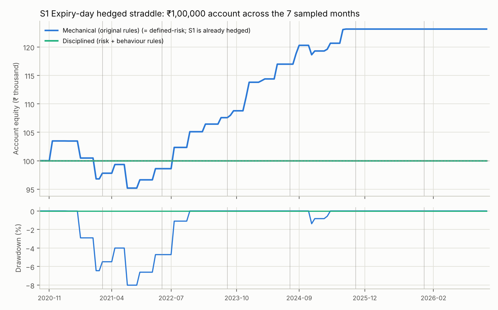
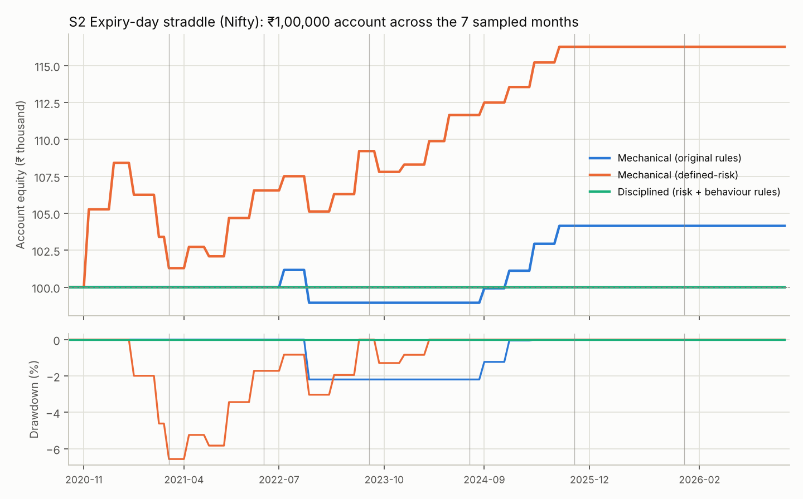
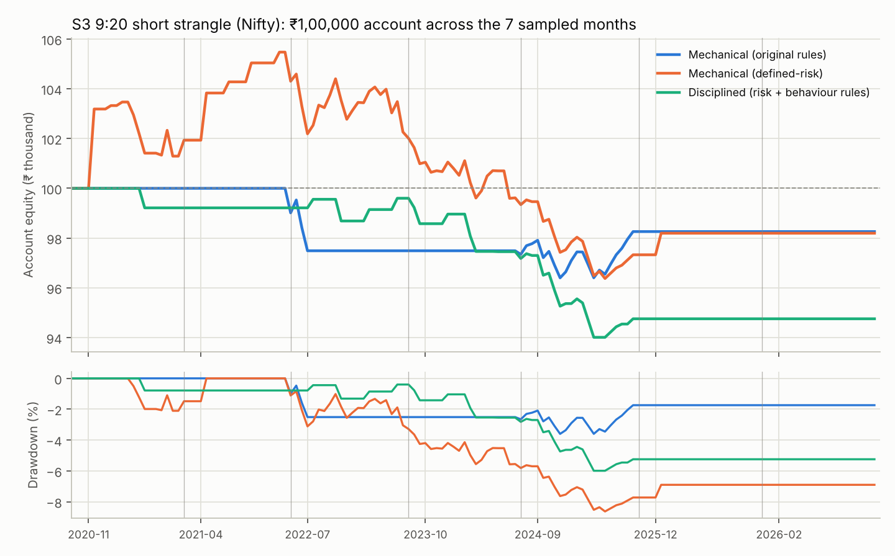

# Stage 2: ₹1,00,000 Paper-Trading Backtest of the Shortlisted F&O Strategies

Status: **complete** · Run date: 2026-11-08 · Follows the [sampled-month study](sampled_month_backtest.md) and the [full-period study](fno_strategy_backtest.md)

> Option prices are modelled from real 1-minute index prices and anchored every day to real NSE closing option prices (validated on ~45,000 real prices: full-period study §2.3). Margins use a documented SPAN + ELM approximation. Nothing here is invented: where data did not exist, it is stated.

## Answers to your eight questions

All amounts are from a ₹1,00,000 starting balance, carried through the seven new random months.
* **Mechanical** = every valid signal at 1 lot, when the margin fits.
* **Disciplined** = your risk-management and behaviour rules applied in full.

**1. How much did each strategy generate?**

| Strategy | Mechanical (original rules) | Mechanical (defined-risk wings) | Disciplined (your rules) |
|---|---:|---:|---:|
| S1 Expiry-day hedged straddle (Nifty + Bank Nifty) | **₹1,23,141** (+₹23,141) | same (already hedged) | **₹1,00,000** (₹0: no trade passed the 1% risk rule) |
| S2 Expiry-day straddle (Nifty) | ₹1,04,154 (+₹4,154) | **₹1,16,274** (+₹16,274) | **₹1,00,000** (₹0: no trade passed the 1% risk rule) |
| S3 9:20 short strangle (Nifty) | ₹98,261 (−₹1,739) | ₹98,195 (−₹1,805) | **₹94,755** (−₹5,245) |

**2. Highest net profit:** **S1**, +₹23,141 with mechanical execution. Under the disciplined rules **no strategy made money**: S1 and S2 could not place a single trade, and S3 lost ₹5,245.

**3. Lowest drawdown:** among strategies with a meaningful number of trades, **S2 with defined-risk wings**: 6.6% (₹7,122), against 8.0% for S1 and 8.6% for S3. The disciplined S1/S2 accounts show 0% only because they never traded.

**4. Most consistent:** **S2 with defined-risk wings**, profitable in **5 of the 5** months it could trade (+2.2% to +4.1% each). S1 was profitable in 4 of 5 (Nov 2020: −3.2%). S3 was profitable in 3 of 6.

**5. Easiest to execute with ₹1 lakh:** under your 1% risk rule, **none**. One lot's planned stop-loss risk exceeded the 1% budget (≈ ₹1,000) on every S1 and S2 signal, and on 103 of 143 S3 signals; another 8 S3 signals failed the 60% margin cap and 4 fell in a cooling-off period. Mechanically, S2 with wings was the easiest (21 of 30 signals marginable, one trade a week). But at **2025–26 lot sizes neither S1 nor S2 could be margined with ₹1 lakh at all**: zero trades in Dec 2025 and Feb 2026.

**6. Best after costs and risk management:** **none.** With your rules, S1 and S2 cannot trade and S3 lost money. After costs alone (mechanical), S1 was best: ₹5,927 of charges on ₹29,068 of pre-charge profit.

**7. Would I deploy real capital?** **No, not with ₹1 lakh.**
* Under the 1% risk rule the account cannot trade S1 or S2.
* At today's lot sizes even 1-lot mechanical trading cannot be margined: about ₹1.2 lakh is needed per lot on expiry day.
* The profitable mechanical runs risk 1.6–2.8% of equity per trade (S2 naked 1.6%, S2 with wings 2.3%, S1 2.8%), which is outside your 0.5–1% limit.
* The mechanical runs are exposed to gaps: one adverse 2% jump on the first expiry of each month turns S1's ₹1,23,141 into ₹27,598.
* S3 lost money in every mode.
* To follow your rules at 2025–26 lot sizes you need about **₹3,91,658 for S1** (≈ ₹3.9 lakh), ₹2,92,687 for S2 (≈ ₹2.9 lakh) and ₹2,08,463 for S3 (≈ ₹2.1 lakh). For context only: at ₹4 lakh and 1% risk, S1 would have ended at ₹4,32,985 (+₹32,985, max drawdown 1.7%).

**8. My selection:**
* **Primary: S1, the expiry-day hedged straddle (Nifty first).** Highest profit and profit factor (2.86). Defined risk. Positive across the full-period study, stage 1 (7/7 months) and stage 2 (4/5 tradeable months).
* **Alternative 1: S2 with defined-risk wings.** The most consistent strategy here and the lowest drawdown. It is the same expiry-day family as S1, so it adds little diversification.
* **Alternative 2: S3, the 9:20 strangle, for paper trading only, not capital.** It lost money in every mode of this test.
* **In practice: keep paper-trading S1 and do not trade real money until the account can follow the 1% rule (≈ ₹3.9 lakh).**

## 1. Test design

### 1.1 Months: one new random month per year (fixed seed 20261109)

The draw excludes the stage-1 months (May 2020, Oct 2021, May 2022, Feb 2023, Jun 2024, Jun 2025, Jan 2026) and is limited to months where complete data exists for both indices, as in stage 1 (2020 from May; 2026 to March):

| Year | Stage-1 month (excluded) | **Stage-2 month** |
|---|---|---|
| 2020 | May 2020 | **Nov 2020** |
| 2021 | Oct 2021 | **Apr 2021** |
| 2022 | May 2022 | **Jul 2022** |
| 2023 | Feb 2023 | **Oct 2023** |
| 2024 | Jun 2024 | **Sep 2024** |
| 2025 | Jun 2025 | **Dec 2025** |
| 2026 | Jan 2026 | **Feb 2026** |

The same months are used for every strategy and every mode. Every trading day was evaluated: 143 trading days, 30 Nifty expiry days and 23 Bank Nifty expiry days. The balance is carried from month to month; no capital is added and nothing is reset.

**Disclosure:** these months are new relative to the stage-1 sample. Apart from Feb 2026, though, they fall inside the 2020–2025 period of the original full-period study. Strategy parameters were **not** changed for this test.

### 1.2 Strategies (rules unchanged)

| Strategy | Rules | Instruments |
|---|---|---|
| **S1** Expiry-day hedged straddle | On each index's expiry day: sell ATM CE + PE at 11:00, buy ~Δ0.01 CE + PE wings; stop each short leg at +50% of its premium; close everything at 15:15 | Nifty and Bank Nifty (Nifty first when both expire the same day) |
| **S2** Expiry-day straddle | Nifty expiry days: sell ATM CE + PE at 9:20; 30% stop per leg; exit 15:15. Defined-risk version adds ~Δ0.01 wings | Nifty |
| **S3** 9:20 short strangle | Every day: sell ~Δ0.20 CE + PE of the nearest expiry at 9:20; 30% stop per leg; exit 15:15. Defined-risk version adds ~Δ0.01 wings | Nifty |

The defined-risk version follows your instruction to use defined risk wherever possible. It uses the same ~Δ0.01 "disaster wing" convention as S1, fixed before this test and not tuned on stage-2 data.

**Instruments not tested:**
* **FINNIFTY:** no 1-minute FINNIFTY data exists in any source reachable from this environment, and its weekly options were discontinued in Nov 2024.
* **Stock F&O:** these are index-option strategies. Stock options have no weekly expiries and too little intraday liquidity for them, so they were not applicable.

### 1.3 Realistic execution

| Item | Treatment |
|---|---|
| Lot sizes | **Exact exchange lot of each contract on each trade date**, read from NSE bhavcopies. Nifty: 75 (Nov 2020, Apr 2021), 50 (Jul 2022, Oct 2023), 25 (Sep 2024), 75/65 (Dec 2025), 65 (Feb 2026). Bank Nifty: 25, 25, 25, 15, 15, 35, 30 |
| Margin | SPAN + ELM approximation (`app/backtesting/margin.py`): naked ≈ 11% of notional; hedged = min(max loss, naked SPAN) + 2% ELM + wing premium; **+2% expiry-day ELM from 20 Nov 2024** |
| Charges | Rates in force on each trade date: ₹20/order brokerage (Upstox); STT 0.05% → 0.0625% (Apr 2023) → 0.1% (Oct 2024) on option premium sold; NSE transaction charges; SEBI ₹10/crore; stamp 0.003% on buys; GST 18% |
| Slippage / bid-ask | max(0.5% of premium, ₹0.10) per option fill, on every entry and exit, reported separately |
| Stops | Checked against each minute's worst price; filled at the stop level, or at the bar's open if the market gapped through it |
| Expiry | All positions are closed at 15:15, so there is no exercise and no exercise STT. Expiry-day ELM is included. Bank Nifty weeklies are used only while they existed (to Nov 2024); after that the monthly expiry is used |
| Look-ahead | Decisions use only closed bars and the previous day's option surface |

### 1.4 The three execution modes

| Rule | Mechanical | Disciplined (all predefined and measurable) |
|---|---|---|
| Which signals | Every valid signal | Every valid signal that passes the checks below |
| Size | 1 lot | ⌊1% × equity ÷ planned risk per lot⌋; skip if < 1 lot |
| Planned risk per lot | — | All short legs stopped at their stop level + exit slippage + wings expiring worthless + all charges |
| Margin | ≤ 90% of equity | ≤ 60% of equity (≥ 40% kept free for MTM swings) |
| Daily loss limit | none | 2% of the day's starting equity: no new entries, and a hard stop that closes any open position when reached |
| Drawdown | none | 10% from peak → pause for the rest of the month and review; resume at 0.5% risk until a new equity high; another pause at each further 10% |
| Losing streak | none | 3 consecutive losses → 2-session cooling-off |
| Overtrading | — | One open position at a time; one entry per setup; no re-entry, no averaging down, no martingale; size never increases after losses |
| Journal | Every entry, exit and skip, with reason | Same |

Not simulated: "emotional mistakes" (per your instruction), random misses and FOMO entries. The strategies only trade at predefined times, so FOMO entries cannot occur.

## 2. Headline results

| Strategy | Mechanical (original rules) | Mechanical (defined-risk) | Disciplined (risk + behaviour rules) |
|---|---:|---:|---:|
| S1 Expiry-day hedged straddle | ₹1,23,141 (+₹23,141; 30 trades) | ₹1,23,141 (+₹23,141; 30 trades) | ₹1,00,000 (₹0; 0 trades) |
| S2 Expiry-day straddle (Nifty) | ₹1,04,154 (+₹4,154; 6 trades) | ₹1,16,274 (+₹16,274; 21 trades) | ₹1,00,000 (₹0; 0 trades) |
| S3 9:20 short strangle (Nifty) | ₹98,261 (−₹1,739; 25 trades) | ₹98,195 (−₹1,805; 76 trades) | ₹94,755 (−₹5,245; 28 trades) |

## 3. Individual strategy reports

### S1: Expiry-day hedged straddle (Nifty + Bank Nifty)

| Performance metric | Mechanical (original rules) | Disciplined (risk + behaviour rules) |
|---|---:|---:|
| Initial capital | ₹1,00,000 | ₹1,00,000 |
| **Final capital** | **₹1,23,141** | **₹1,00,000** |
| Net profit / loss | +₹23,141 | ₹0 |
| Total return | +23.14% | +0.00% |
| Valid signals | 53 | 53 |
| Total trades | 30 | 0 |
| Winning trades | 25 | 0 |
| Losing trades | 5 | 0 |
| Win rate | 83.3% | — |
| Gross profit (winning trades, after charges) | ₹35,610 | ₹0 |
| Gross loss (losing trades, after charges) | −₹12,468 | ₹0 |
| P&L before charges | +₹29,068 | ₹0 |
| Transaction costs (brokerage, STT, exchange, GST, SEBI, stamp) | ₹5,927 | ₹0 |
| Slippage / bid-ask (already inside P&L) | ₹1,810 | ₹0 |
| Maximum drawdown | 8.0% (₹8,285) | 0.0% (₹0) |
| Profit factor | 2.86 | — |
| Average profit per winning trade | ₹1,424 | — |
| Average loss per losing trade | −₹2,494 | — |
| Largest winning trade | ₹3,738 | — |
| Largest losing trade | −₹4,143 | — |
| Maximum consecutive losses | 3 | 0 |
| Maximum consecutive wins | 17 | 0 |
| Risk-to-reward (avg win ÷ avg loss) | 0.57 | — |
| Capital utilisation (avg margin ÷ equity, per trade) | 43.6% | 0.0% |
| Planned risk per trade (avg, % of equity) | 2.8% | 0.0% |
| Trades skipped due to risk / margin / rules | 23 | 53 |
| Drawdown pauses / cooling-off periods | 0 / 0 | 0 / 0 |
| Longest time under water (sessions) | 39 | 0 |
| Worst day (% of equity) | -4.17% | +0.00% |

**Why signals were skipped**

| Mode | Reasons (count) |
|---|---|
| Mechanical (original rules) | insufficient margin: 23 |
| Disciplined (risk + behaviour rules) | risk limit: 53 |

**Month-wise (= year-wise; one sampled month per year)**

| Month | Mechanical (original rules): trades · net · month return · end balance | Disciplined (risk + behaviour rules): trades · net · month return · end balance |
|---|---|---|
| 2020-11 | 4 · −₹3,194 · -3.19% · ₹96,806 | 0 · ₹0 · +0.00% · ₹1,00,000 |
| 2021-04 | 5 · +₹1,795 · +1.85% · ₹98,601 | 0 · ₹0 · +0.00% · ₹1,00,000 |
| 2022-07 | 5 · +₹8,969 · +9.10% · ₹1,07,570 | 0 · ₹0 · +0.00% · ₹1,00,000 |
| 2023-10 | 8 · +₹9,402 · +8.74% · ₹1,16,972 | 0 · ₹0 · +0.00% · ₹1,00,000 |
| 2024-09 | 8 · +₹6,169 · +5.27% · ₹1,23,141 | 0 · ₹0 · +0.00% · ₹1,00,000 |
| 2025-12 | 0 · ₹0 · +0.00% · ₹1,23,141 | 0 · ₹0 · +0.00% · ₹1,00,000 |
| 2026-02 | 0 · ₹0 · +0.00% · ₹1,23,141 | 0 · ₹0 · +0.00% · ₹1,00,000 |

**Winning / losing streaks** (lengths in order of occurrence)

| Mode | Winning streaks | Losing streaks |
|---|---|---|
| Mechanical (original rules) | [1, 2, 17, 5] | [3, 1, 1] |
| Disciplined (risk + behaviour rules) | — | — |



### S2: Expiry-day straddle (Nifty)

| Performance metric | Mechanical (original rules) | Mechanical (defined-risk) | Disciplined (risk + behaviour rules) |
|---|---:|---:|---:|
| Initial capital | ₹1,00,000 | ₹1,00,000 | ₹1,00,000 |
| **Final capital** | **₹1,04,154** | **₹1,16,274** | **₹1,00,000** |
| Net profit / loss | +₹4,154 | +₹16,274 | ₹0 |
| Total return | +4.15% | +16.27% | +0.00% |
| Valid signals | 30 | 30 | 30 |
| Total trades | 6 | 21 | 0 |
| Winning trades | 5 | 15 | 0 |
| Losing trades | 1 | 6 | 0 |
| Win rate | 83.3% | 71.4% | — |
| Gross profit (winning trades, after charges) | ₹6,374 | ₹27,830 | ₹0 |
| Gross loss (losing trades, after charges) | −₹2,221 | −₹11,556 | ₹0 |
| P&L before charges | +₹4,773 | +₹20,481 | ₹0 |
| Transaction costs (brokerage, STT, exchange, GST, SEBI, stamp) | ₹620 | ₹4,207 | ₹0 |
| Slippage / bid-ask (already inside P&L) | ₹290 | ₹1,655 | ₹0 |
| Maximum drawdown | 2.2% (₹2,221) | 6.6% (₹7,122) | 0.0% (₹0) |
| Profit factor | 2.87 | 2.41 | — |
| Average profit per winning trade | ₹1,275 | ₹1,855 | — |
| Average loss per losing trade | −₹2,221 | −₹1,926 | — |
| Largest winning trade | ₹1,822 | ₹5,272 | — |
| Largest losing trade | −₹2,221 | −₹2,847 | — |
| Maximum consecutive losses | 1 | 3 | 0 |
| Maximum consecutive wins | 4 | 7 | 0 |
| Risk-to-reward (avg win ÷ avg loss) | 0.57 | 0.96 | — |
| Capital utilisation (avg margin ÷ equity, per trade) | 75.6% | 52.8% | 0.0% |
| Planned risk per trade (avg, % of equity) | 1.6% | 2.3% | 0.0% |
| Trades skipped due to risk / margin / rules | 24 | 9 | 30 |
| Drawdown pauses / cooling-off periods | 0 / 0 | 0 / 0 | 0 / 0 |
| Longest time under water (sessions) | 45 | 45 | 0 |
| Worst day (% of equity) | -2.19% | -2.68% | +0.00% |

**Why signals were skipped**

| Mode | Reasons (count) |
|---|---|
| Mechanical (original rules) | insufficient margin: 24 |
| Mechanical (defined-risk) | insufficient margin: 9 |
| Disciplined (risk + behaviour rules) | risk limit: 30 |

**Month-wise (= year-wise; one sampled month per year)**

| Month | Mechanical (original rules): trades · net · month return · end balance | Mechanical (defined-risk): trades · net · month return · end balance | Disciplined (risk + behaviour rules): trades · net · month return · end balance |
|---|---|---|---|
| 2020-11 | 0 · ₹0 · +0.00% · ₹1,00,000 | 4 · +₹3,409 · +3.41% · ₹1,03,409 | 0 · ₹0 · +0.00% · ₹1,00,000 |
| 2021-04 | 0 · ₹0 · +0.00% · ₹1,00,000 | 5 · +₹3,143 · +3.04% · ₹1,06,552 | 0 · ₹0 · +0.00% · ₹1,00,000 |
| 2022-07 | 2 · −₹1,051 · -1.05% · ₹98,949 | 4 · +₹2,664 · +2.50% · ₹1,09,216 | 0 · ₹0 · +0.00% · ₹1,00,000 |
| 2023-10 | 0 · ₹0 · +0.00% · ₹98,949 | 4 · +₹2,439 · +2.23% · ₹1,11,655 | 0 · ₹0 · +0.00% · ₹1,00,000 |
| 2024-09 | 4 · +₹5,204 · +5.26% · ₹1,04,154 | 4 · +₹4,619 · +4.14% · ₹1,16,274 | 0 · ₹0 · +0.00% · ₹1,00,000 |
| 2025-12 | 0 · ₹0 · +0.00% · ₹1,04,154 | 0 · ₹0 · +0.00% · ₹1,16,274 | 0 · ₹0 · +0.00% · ₹1,00,000 |
| 2026-02 | 0 · ₹0 · +0.00% · ₹1,04,154 | 0 · ₹0 · +0.00% · ₹1,16,274 | 0 · ₹0 · +0.00% · ₹1,00,000 |

**Winning / losing streaks** (lengths in order of occurrence)

| Mode | Winning streaks | Losing streaks |
|---|---|---|
| Mechanical (original rules) | [1, 4] | [1] |
| Mechanical (defined-risk) | [2, 1, 3, 2, 7] | [3, 1, 1, 1] |
| Disciplined (risk + behaviour rules) | — | — |



### S3: 9:20 short strangle (Nifty)

| Performance metric | Mechanical (original rules) | Mechanical (defined-risk) | Disciplined (risk + behaviour rules) |
|---|---:|---:|---:|
| Initial capital | ₹1,00,000 | ₹1,00,000 | ₹1,00,000 |
| **Final capital** | **₹98,261** | **₹98,195** | **₹94,755** |
| Net profit / loss | −₹1,739 | −₹1,805 | −₹5,245 |
| Total return | -1.74% | -1.80% | -5.24% |
| Valid signals | 143 | 143 | 143 |
| Total trades | 25 | 76 | 28 |
| Winning trades | 14 | 41 | 13 |
| Losing trades | 11 | 35 | 15 |
| Win rate | 56.0% | 53.9% | 46.4% |
| Gross profit (winning trades, after charges) | ₹4,400 | ₹18,334 | ₹2,961 |
| Gross loss (losing trades, after charges) | −₹6,139 | −₹20,139 | −₹8,206 |
| P&L before charges | +₹711 | +₹12,880 | +₹123 |
| Transaction costs (brokerage, STT, exchange, GST, SEBI, stamp) | ₹2,450 | ₹14,684 | ₹5,367 |
| Slippage / bid-ask (already inside P&L) | ₹497 | ₹3,215 | ₹801 |
| Maximum drawdown | 3.6% (₹3,599) | 8.6% (₹9,100) | 6.0% (₹5,991) |
| Profit factor | 0.72 | 0.91 | 0.36 |
| Average profit per winning trade | ₹314 | ₹447 | ₹228 |
| Average loss per losing trade | −₹558 | −₹575 | −₹547 |
| Largest winning trade | ₹518 | ₹3,187 | ₹460 |
| Largest losing trade | −₹1,116 | −₹1,297 | −₹881 |
| Maximum consecutive losses | 3 | 4 | 4 |
| Maximum consecutive wins | 5 | 6 | 4 |
| Risk-to-reward (avg win ÷ avg loss) | 0.56 | 0.78 | 0.42 |
| Capital utilisation (avg margin ÷ equity, per trade) | 74.5% | 57.5% | 43.4% |
| Planned risk per trade (avg, % of equity) | 0.7% | 1.1% | 0.8% |
| Trades skipped due to risk / margin / rules | 118 | 67 | 115 |
| Drawdown pauses / cooling-off periods | 0 / 0 | 0 / 0 | 0 / 2 |
| Longest time under water (sessions) | 105 | 105 | 131 |
| Worst day (% of equity) | -1.12% | -1.24% | -0.89% |

**Why signals were skipped**

| Mode | Reasons (count) |
|---|---|
| Mechanical (original rules) | insufficient margin: 118 |
| Mechanical (defined-risk) | insufficient margin: 67 |
| Disciplined (risk + behaviour rules) | risk limit: 103, margin limit: 8, cooling-off after 3 consecutive losses: 4 |

**Month-wise (= year-wise; one sampled month per year)**

| Month | Mechanical (original rules): trades · net · month return · end balance | Mechanical (defined-risk): trades · net · month return · end balance | Disciplined (risk + behaviour rules): trades · net · month return · end balance |
|---|---|---|---|
| 2020-11 | 0 · ₹0 · +0.00% · ₹1,00,000 | 9 · +₹1,293 · +1.29% · ₹1,01,293 | 1 · −₹786 · -0.79% · ₹99,214 |
| 2021-04 | 0 · ₹0 · +0.00% · ₹1,00,000 | 5 · +₹4,181 · +4.13% · ₹1,05,474 | 0 · ₹0 · +0.00% · ₹99,214 |
| 2022-07 | 4 · −₹2,511 · -2.51% · ₹97,489 | 21 · −₹3,211 · -3.04% · ₹1,02,264 | 4 · +₹386 · +0.39% · ₹99,600 |
| 2023-10 | 0 · ₹0 · +0.00% · ₹97,489 | 19 · −₹2,647 · -2.59% · ₹99,617 | 6 · −₹2,147 · -2.16% · ₹97,453 |
| 2024-09 | 21 · +₹772 · +0.79% · ₹98,261 | 21 · −₹2,289 · -2.30% · ₹97,328 | 17 · −₹2,698 · -2.77% · ₹94,755 |
| 2025-12 | 0 · ₹0 · +0.00% · ₹98,261 | 1 · +₹868 · +0.89% · ₹98,195 | 0 · ₹0 · +0.00% · ₹94,755 |
| 2026-02 | 0 · ₹0 · +0.00% · ₹98,261 | 0 · ₹0 · +0.00% · ₹98,195 | 0 · ₹0 · +0.00% · ₹94,755 |

**Winning / losing streaks** (lengths in order of occurrence)

| Mode | Winning streaks | Losing streaks |
|---|---|---|
| Mechanical (original rules) | [1, 3, 1, 3, 1, 5] | [1, 3, 1, 2, 3, 1] |
| Mechanical (defined-risk) | [3, 1, 5, 1, 2, 2, 2, 2, 1, 1, 1, 1, 1, 1, 3, 1, 1, 1, 1, 3, 1, 6] | [4, 1, 1, 2, 1, 2, 1, 1, 1, 4, 1, 1, 2, 2, 2, 1, 1, 1, 2, 3, 1] |
| Disciplined (risk + behaviour rules) | [1, 2, 1, 1, 1, 1, 2, 4] | [1, 1, 2, 4, 1, 1, 2, 3] |



**Why S3's disciplined account did worse than the mechanical ones:** the 1% filter only lets through days when one lot's planned risk is small. Those are low-premium days, where the wing cost and charges take a large share of a small credit. The filter therefore selects S3's weakest days. The same pattern appears in the context-only ₹4 lakh what-if below, where S3 makes money once most of its signals can be taken.

## 4. Stress tests

Gap scenario: an instantaneous ±1% or ±2% index jump one hour after entry on the **first signal day of each month** (S1: both indices, 14 events; S2 and S3: 7 events). The worse direction is shown. Stops fill after the jump.

| Scenario | S1 mechanical | S1 disciplined | S2 mechanical | S2 disciplined | S3 mechanical | S3 disciplined |
|---|---:|---:|---:|---:|---:|---:|
| Base case | ₹1,23,141 ✅, DD 8.0% | ₹1,00,000 ➖, DD 0.0% | ₹1,04,154 ✅, DD 2.2% | ₹1,00,000 ➖, DD 0.0% | ₹98,261 ❌, DD 3.6% | ₹94,755 ❌, DD 6.0% |
| Slippage +25% | ₹1,22,834 ✅, DD 8.1% | ₹1,00,000 ➖, DD 0.0% | ₹1,04,107 ✅, DD 2.2% | ₹1,00,000 ➖, DD 0.0% | ₹98,178 ❌, DD 3.7% | ₹95,226 ❌, DD 5.5% |
| Transaction charges +50% | ₹1,20,178 ✅, DD 8.6% | ₹1,00,000 ➖, DD 0.0% | ₹1,03,844 ✅, DD 2.2% | ₹1,00,000 ➖, DD 0.0% | ₹97,035 ❌, DD 4.5% | ₹93,556 ❌, DD 6.7% |
| Win rate −10 pp (smallest winners become average losers) | ₹1,13,778 ✅, DD 8.0% | n/a (no trades) | ₹1,00,871 ✅, DD 4.3% | n/a (no trades) | ₹96,142 ❌, DD 5.7% | ₹92,987 ❌, DD 7.7% |
| Losing streak: 5 full planned-risk losses first | ₹1,10,077 ✅, DD 14.9% | n/a (no trades) | ₹95,993 ❌, DD 8.8% | n/a (no trades) | ₹95,282 ❌, DD 6.5% | ₹91,244 ❌, DD 9.5% |
| Worst ordering of actual trades (all losses first) | ₹1,23,165 ✅, DD 11.6% | n/a (no trades) | ₹1,04,154 ✅, DD 2.2% | n/a (no trades) | ₹98,261 ❌, DD 6.1% | ₹94,755 ❌, DD 8.1% |
| Reduced capital: start ₹75,000 | ₹93,261 ✅ | ₹75,000 ➖ | ₹75,000 ➖ | ₹75,000 ➖ | ₹75,000 ➖ | ₹71,950 ❌ |
| Reduced capital: start ₹50,000 | ₹67,020 ✅ | ₹50,000 ➖ | ₹50,000 ➖ | ₹50,000 ➖ | ₹50,000 ➖ | ₹50,000 ➖ |
| Gap ±1% one hour after entry, first signal each month | ₹73,841 ❌, DD 30.7% | ₹1,00,000 ➖, DD 0.0% | ₹93,488 ❌, DD 10.7% | ₹1,00,000 ➖, DD 0.0% | ₹96,209 ❌, DD 5.7% | ₹92,947 ❌, DD 7.8% |
| Gap ±2% one hour after entry, first signal each month | ₹27,598 ❌, DD 73.1% | ₹1,00,000 ➖, DD 0.0% | ₹75,659 ❌, DD 24.3% | ₹1,00,000 ➖, DD 0.0% | ₹91,824 ❌, DD 10.0% | ₹89,550 ❌, DD 10.5% |

✅ profitable · ➖ no trades/unchanged · ❌ loss versus the starting balance.

**What survives adverse conditions:**
* **S1 (mechanical)** stays profitable under +25% slippage, +50% charges, a 10-point lower win rate, a 5-trade full-risk losing streak, the worst possible ordering and reduced capital (₹75k → ₹93,261; ₹50k → ₹67,020).
* **S1 is not robust to gaps:** ±1% gaps take the account to ₹73,841 and ±2% gaps to ₹27,598. At today's lot sizes a single 2% jump costs about ₹33–35k on one lot even with the wings.
* **S2** (naked, mechanical) survives the cost stresses but not the losing streak or the gaps. It cannot trade at all with ₹75k or ₹50k.
* **S3** loses in every scenario.

## 5. What it would take to follow your rules

| Strategy | Median planned risk per lot | Median margin per lot | Capital needed (risk ÷ 1%, margin ÷ 60%) |
|---|---:|---:|---:|
| S1 Expiry-day hedged straddle | ₹3,917 | ₹1,20,691 | **₹3,91,658** |
| S2 Expiry-day straddle (Nifty) | ₹2,927 | ₹1,26,995 | **₹2,92,687** |
| S3 9:20 short strangle (Nifty) | ₹1,781 | ₹1,25,078 | **₹2,08,463** |

| Strategy | 2020-11 | 2021-04 | 2022-07 | 2023-10 | 2024-09 | 2025-12 | 2026-02 |
|---|---:|---:|---:|---:|---:|---:|---:|
| S1 Expiry-day hedged straddle: median planned risk per lot | ₹4,039 | ₹5,123 | ₹3,478 | ₹2,041 | ₹1,909 | ₹3,540 | ₹4,692 |
| S2 Expiry-day straddle (Nifty): median planned risk per lot | ₹2,842 | ₹3,184 | ₹2,433 | ₹1,624 | ₹1,477 | ₹2,654 | ₹3,305 |
| S3 9:20 short strangle (Nifty): median planned risk per lot | ₹1,684 | ₹2,058 | ₹1,306 | ₹992 | ₹759 | ₹1,547 | ₹1,849 |

| Strategy | 2% risk per trade, ₹1 lakh | 1% risk per trade, ₹4 lakh |
|---|---|---|
| S1 Expiry-day hedged straddle | ₹1,06,382 (+₹6,382, 10 trades, max DD 1.5%) | ₹4,32,985 (+₹32,985, 28 trades, max DD 1.7%) |
| S2 Expiry-day straddle (Nifty) | ₹1,08,236 (+₹8,236, 9 trades, max DD 1.4%) | ₹4,22,802 (+₹22,802, 30 trades, max DD 2.7%) |
| S3 9:20 short strangle (Nifty) | ₹93,581 (−₹6,419, 36 trades, max DD 7.4%) | ₹4,12,828 (+₹12,828, 133 trades, max DD 3.0%) |

These what-ifs break your stated rules. They are shown only to answer "what would make these strategies tradeable" and are not part of the ranking.

## 6. Consolidated comparison and ranking

| Strategy | Signals | Trades taken | Final balance | Status |
|---|---:|---:|---:|---|
| S1 Expiry-day hedged straddle | 53 | 0 | ₹1,00,000 (₹0) | **Not executable**: one lot's planned stop-loss risk exceeded 1% of equity on every signal |
| S2 Expiry-day straddle (Nifty) | 30 | 0 | ₹1,00,000 (₹0) | **Not executable**: one lot's planned stop-loss risk exceeded 1% of equity on every signal |
| S3 9:20 short strangle (Nifty) | 143 | 28 | ₹94,755 (−₹5,245) | Executable, **loss-making** |

Under your rules, S1 and S2 cannot trade and S3 loses money, so a ranking of the disciplined results would only rank "did nothing" against "lost money". The eight-criterion ranking therefore uses the **mechanical defined-risk** results. That is the realistic 1-lot execution of each strategy, with margin, costs and defined risk, but without the 1% cap.

| Criterion | S1 Expiry-day hedged straddle | S2 Expiry-day straddle (Nifty) | S3 9:20 short strangle (Nifty) |
|---|---|---|---|
| Net profit (₹) | +₹23,141 (#1) | +₹16,274 (#2) | −₹1,805 (#3) |
| Risk-adjusted (daily Sharpe) | 2.71 (#1) | 2.20 (#2) | -0.36 (#3) |
| Max drawdown (lower better) | 8.0% (#2) | 6.6% (#1) | 8.6% (#3) |
| Consistency (profitable months) | 4/5 traded months (#2) | 5/5 traded months (#1) | 3/6 traded months (#3) |
| Profit factor | 2.86 (#1) | 2.41 (#2) | 0.91 (#3) |
| Capital efficiency (net ÷ avg margin) | 0.50 (#1) | 0.29 (#2) | -0.03 (#3) |
| Practical execution (% signals taken) | 57% (#2) | 70% (#1) | 53% (#3) |
| Psychological sustainability | max 3 losses in a row, worst day -4.2%, 39 sessions under water (#2) | max 3 losses in a row, worst day -2.7%, 45 sessions under water (#1) | max 4 losses in a row, worst day -1.2%, 105 sessions under water (#3) |
| **Average rank** | **1.50** | **1.50** | **3.00** |

Order: S1 Expiry-day hedged straddle (1.50) → S2 Expiry-day straddle (Nifty) (1.50) → S3 9:20 short strangle (Nifty) (3.00). Ties are broken by criterion 1 (net profit).

Psychological sustainability combines the longest run of consecutive losses, the worst single day and the longest time under water. Weekly strategies (S1, S2) also need far less screen time than the daily S3.

## 7. Limitations

* **Seven months, small samples:** 6–76 trades per account. Treat results as evidence, not forecasts.
* **Only two sampled months (Dec 2025, Feb 2026) use today's contract sizes,** and in both, S1 and S2 could not be margined with ₹1 lakh. **The mechanical profits all come from 2020–2024,** when lots were smaller.
* **Modelled option prices** (validated daily anchor; modelled intraday path). The main untested risk remains real afternoon decay on expiry days (full-period study §6.4).
* **Approximate margins:** not NSE SPAN files. Brokers may charge more.
* **Gap stresses are deterministic scenarios,** not forecasts of how often gaps happen.
* **Not modelled:** order rejections, partial fills and broker outages. The wings bound, but do not remove, the cost of a stop failing.
* **Calendar correction:** while preparing this stage, a Bank Nifty expiry-calendar bug (6 non-existent Wednesdays between Sep 2023 and Feb 2024) was found and fixed. The calendar now matches NSE's actual expiries exactly (Nifty 316/316 and Bank Nifty 258/258 dates, Apr 2020 – Apr 2026). Earlier reports were re-run; see the note in the full-period study.

## 8. Trade ledger, journal and code

* Ledgers (every executed trade: lots, quantity, margin, planned risk, pre-charge P&L, charges, slippage, net, equity after): `docs/research/stage2/S*_<mode>_ledger.csv`
* Journals (every entry, exit, skip and rule trigger, with its reason): `docs/research/stage2/S*_<mode>_journal.csv`
* Account rules: `backend/app/backtesting/account.py` (tests: `backend/tests/unit/test_account_rules.py`)
* Runner and report: `backend/research/stage2.py`, `backend/research/stage2_report.py`, `backend/research/stage2_doc.py`

```bash
./scripts/fetch_research_data.sh
```

```bash
cd backend && uv run python -m research.lot_table 2 && uv run python -m research.stage2 && uv run python -m research.stage2_report && uv run python -m research.stage2_doc
```
